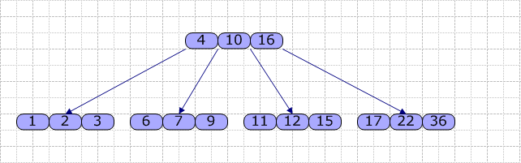
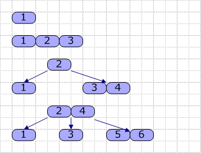
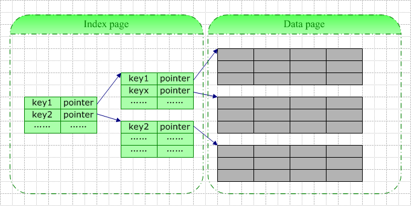
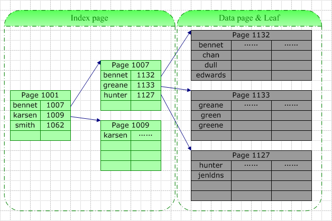
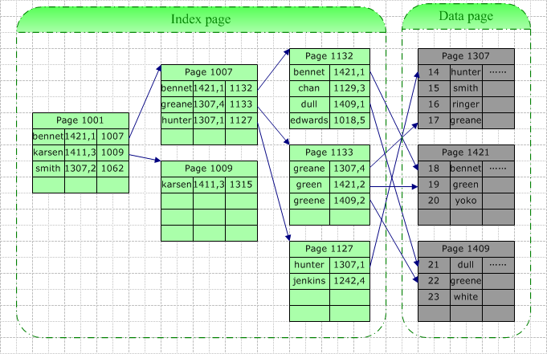

## 一、引言

对数据库索引的关注从未淡出我们的讨论，那么数据库索引是什么样的？聚集索引与非聚集索引有什么不同？希望本文对各位同仁有一定的帮助。有不少存疑的地方，诚心希望各位不吝赐教指正，共同进步。

## 二、B 树

常见的关系型数据库会使用 B 树或 B+ 树一类的结构实现索引。原文以 SQL Server、Oracle 和 Sybase 等数据库为背景。先从 B 树的结构说起。

二叉树的每个节点最多有两个子节点。对一棵 M 阶 B 树，常见的定义如下。

1. 每个节点至多有M个孩子。
2. 除根节点和叶端的外部节点外，每个内部节点至少有 ⌈M/2⌉ 个子节点。
3. 根节点至少有两个孩子（除非该树仅包含一个节点）。
4. 所有叶端在同一层。本文的示意图用不含关键字的外部节点表示查找终止的位置。
5. 含有 K 个关键字的内部节点有 K + 1 个子树分支。

同一节点内的关键字按从小到大的顺序排列。下图是一棵 4 阶 B 树。

节点可以用关键字数组 `Key[]` 和子节点指针数组 `Son[]` 来表示。查找时，可在 `Key[]` 中顺序查找或二分查找。如果找到关键字 `K`，就返回节点及其位置。否则，根据 `K` 落在哪个区间，沿对应的子节点指针继续查找，直到命中或到达查找路径的末端。

下面演示如何构造一棵 4 阶 B 树，依次插入 1 到 6。

插入 4 时，原节点已满，需要分裂。按图中的做法，中间关键字 2 提升为根节点，其余关键字分到两侧。后续插入可以用同样的方式理解。

## 三、数据库索引

下文沿用原文的页组织示例。具体的页布局、行定位符和分配行为取决于数据库产品、版本与索引类型。

### 1. 什么是索引

在数据库中，索引的含义与日常意义上的“索引”一词并无多大区别（想想小时候查字典），它是用于提高数据库表数据访问速度的数据库对象。

- 索引可以避免全表扫描。多数查询可以仅扫描少量索引页及数据页，而不是遍历所有数据页。
- 非聚集索引覆盖查询所需字段时，可以直接在索引中取得结果。
- 聚集索引能按键值组织插入位置。在键值分散时，写入可以分布到不同的数据页。
- 一些情况下，索引还可用于避免排序操作。

索引能加快查询，但也带来写入开销。数据更新时，相关索引通常也需要维护。

### 2. 索引的存储

索引记录通常包含按索引定义组织的键值，以及用于定位数据行或下一级索引页的信息。

当你为一张空表创建索引时，数据库系统将为你分配一个索引页，该索引页在你插入数据前一直是空的。此页此时既是根节点，也是叶节点。每当你往表中插入一行数据，数据库系统即向此根节点中插入一行索引记录。当根节点满时，数据库系统大抵按以下步骤进行分裂：

- 创建两个儿子节点。
- 将原根节点中的数据近似地拆成两半，分别写入新的两个儿子节点。
- 根节点中加上指向两个儿子节点的指针。

索引记录通常比完整的数据行小，一个索引页能容纳更多记录。原文所讨论的实现中，定位指针约占 4 至 9 字节。更紧凑的索引页能减少查找时需要读取的页数。

### 3. 索引的类型

- 聚集索引。在本文的示例中，数据行本身储存在索引的叶层，按索引键组织。
- 非聚集索引。叶层包含索引键和行定位信息，数据行另外存放。

在这种组织方式下，一张表只有一种聚集顺序，因此只能建立一个聚集索引。没有聚集索引的表称为堆（Heap），其中的数据行没有按索引键排列的顺序。

### 4. 聚集索引

在聚集索引中，叶节点也是数据节点，数据行按索引键组织。

#### 查询

如图所示，在名字字段上建立聚集索引后，可以从根节点沿指针逐层查找。例如查询 `Green`，先进入索引页 `1007`，再到叶节点 `1133`，最终找到对应的数据行。

这个例子访问了三个页，最后一个就是数据页。其中有些页可能已经在缓存里，因此实际的磁盘读取次数可以少于三次。

#### 插入

最简单的情况下，插入操作根据索引找到对应的数据页，然后通过挪动已有的记录为新数据腾出空间，最后插入数据。

如果数据页已满，则需要拆分数据页（页拆分是一种耗费资源的操作，一般数据库系统中会有相应的机制要尽量减少页拆分的次数，通常是通过为每页预留空间来实现）：

- 在该使用的数据段（extent）上分配新的数据页，如果数据段已满，则需要分配新段。
- 调整索引指针，这需要将相应的索引页读入内存并加锁。
- 大约有一半的数据行被归入新的数据页中。
- 如果表还有非聚集索引，则需要更新这些索引指向新的数据页。

某些情况会采用不同的处理方式。

- 如果新插入的一条记录包含很大的数据，可能会分配两个新数据页，其中之一用来存储新记录，另一存储从原页中拆分出来的数据。
- 通常数据库系统中会将重复的数据记录存储于相同的页中。
- 如果按自增列聚集，新行往往加在索引末端。数据库可以分配新页继续插入。

#### 删除

删除行将导致其下方的数据行向上移动以填充删除记录造成的空白。

如果删除的行是该数据页中的最后一行，那么该数据页将被回收，相应的索引页中的记录将被删除。如果回收的数据页位于跟该表的其它数据页相同的段上，那么它可能在随后的时间内被利用。如果该数据页是该段的唯一一个数据页，则该段也被回收。

对于数据的删除操作，可能导致索引页中仅有一条记录，这时，该记录可能会被移至邻近的索引页中，原索引页将被回收，即所谓的“索引合并”。

### 5. 非聚集索引

在这个示例中，非聚集索引有以下特点。

- 叶子节点并非数据节点。
- 叶子节点为每一真正的数据行存储一个“键-指针”对。
- 叶子节点中还存储了一个指针偏移量，根据页指针及指针偏移量可以定位到具体的数据行。
- 类似的，在除叶节点外的其它索引节点，存储的也是类似的内容，只不过它是指向下一级的索引页的。

在这套示例里，聚集索引属于稀疏索引，数据页上一级的索引页用页指针定位。非聚集索引属于密集索引，叶层为数据行保存索引记录。

对于根与中间级的索引记录，它的结构包括：

- 索引字段值。
- RowId（即对应数据页的页指针+指针偏移量）。在高层的索引页中包含RowId是为了当索引允许重复值时，当更改数据时精确定位数据行。
- 下一级索引页的指针。

对于叶子层的索引对象，它的结构包括：

- 索引字段值。
- RowId。

#### 查询

按图查找 `Green`，需要访问三个索引页和一个数据页。命中缓存时，实际磁盘读取次数可以更少。

#### 插入

插入新行后，数据库会更新相关非聚集索引。有聚集索引时，聚集索引的键顺序也决定新行的写入位置。

#### 删除

如果 `WHERE` 条件所涉及的列有非聚集索引，数据库可以用该索引定位数据行。删除数据后，也需要删除各个相关索引叶层中的对应记录。

如果被删的是该数据页唯一的一行，页可能被回收，数据库也需要更新相应的索引定位信息。

频繁随机删除可能留下多个只含少量数据的页，实际是否合并取决于数据库的实现。

### 6. 索引覆盖

当一个索引已经包含查询所需的所有信息时，查询可以直接从索引拿到结果。

包含多个字段的索引称为复合索引。原参考资料涉及的实现示例中，索引最多包含 31 个字段，索引记录最长为 600 字节，其他产品和版本的限制可能不同。如果查询的 `SELECT`、`WHERE`、`ORDER BY`、`GROUP BY` 和 `HAVING` 所需字段都在一个复合非聚集索引中，执行时就可能只访问索引页。这种情况称为索引覆盖。

在索引覆盖的情况下，包含两种索引扫描：

- 匹配索引扫描。
- 非匹配索引扫描。

#### 匹配索引扫描

此类索引扫描可以让我们省去访问数据页的步骤，当查询仅返回一行数据时，性能提高是有限的，但在范围查询的情况下，性能提高将随结果集数量的增长而增长。

这类扫描既要求索引包含查询需要的字段，也要看 `WHERE` 条件能否使用索引的引导列。例如复合索引按 `A`、`B`、`C`、`D` 排列时，引导列是 `A`。这里的匹配扫描可以从引导列限定扫描范围。

#### 非匹配索引扫描

如果条件只涉及 `B/C/D` 或 `B/D`，在本文所讨论的扫描方式中，引擎可能扫描整个索引叶层。因为索引页通常更紧凑，这仍可能比扫描全部数据页更省 I/O。

## 参考资料

- [Sybase ASE 旧版性能指南](http://manuals.sybase.com/onlinebooks/group-asarc/asg1200e/aseperf/@Generic__BookTextView/3358)

- [IBM Informix 旧版文档](http://publib.boulder.ibm.com/infocenter/idshelp/v10/index.jsp?topic=/com.ibm.adref.doc/adref235.htm)
