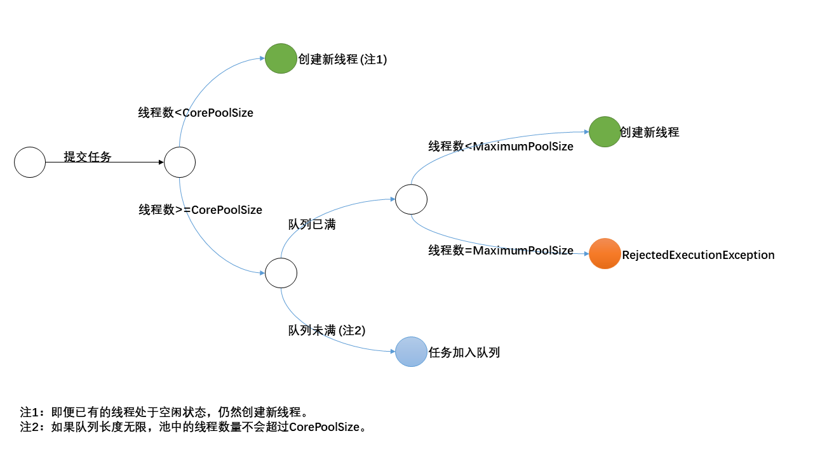

线程池的作用，是复用线程，并控制任务执行所消耗的资源。配置线程池时，需要同时回答三个问题：最多并行执行多少任务，允许多少任务排队，超过处理能力后怎么办。

`ExecutorService` 是管理任务提交、结果和生命周期的接口；`ThreadPoolExecutor` 是常用实现；`Executors` 则提供创建线程池的工厂方法。理解这些工厂方法之前，先看线程池的参数。

## 1. ThreadPoolExecutor 的参数

完整构造器包含七个参数：

```java
ThreadPoolExecutor pool = new ThreadPoolExecutor(
    corePoolSize,
    maximumPoolSize,
    keepAliveTime,
    unit,
    workQueue,
    threadFactory,
    handler
);
```

| 参数 | 含义 |
| --- | --- |
| `corePoolSize` | 核心线程数。默认按需创建，并非初始化时就全部启动 |
| `maximumPoolSize` | 池内工作线程数的上限，必须不小于核心线程数 |
| `keepAliveTime` | 空闲线程等待新任务的存活时间，默认用于超过核心数量的线程 |
| `unit` | 存活时间的单位 |
| `workQueue` | 保存尚未执行的任务的队列，其容量直接影响扩容和拒绝行为 |
| `threadFactory` | 创建工作线程，可设置线程名和未捕获异常处理器等 |
| `handler` | 无法接收任务时采用的拒绝策略 |

### 任务先排队，还是先增加线程？

在线程池处于运行状态、线程能够正常创建的情况下，提交任务大致经过以下步骤：

1. 当前线程数小于 `corePoolSize`，创建工作线程执行任务，即使其他线程此时可能空闲。
2. 已达到核心线程数，优先尝试将任务放入队列。
3. 队列无法接收任务，且线程数小于 `maximumPoolSize`，才继续创建线程。
4. 队列无法接收，线程数也已达到上限，触发拒绝策略。

因此，**达到核心线程数以后，先尝试排队，队列放不下才扩容**。实际实现还会复查线程池状态，处理提交期间发生关闭等并发情况。



图中最后一步的 `RejectedExecutionException` 对应默认的 `AbortPolicy`。如果更换拒绝策略，结果也会改变；关闭后的线程池同样可能拒绝任务。

### 三类常见队列

| 队列 | 特点 | 对线程池的影响 |
| --- | --- | --- |
| `SynchronousQueue` | 不保存任务，每次提交都需要与接收线程交接 | 无法交接时尝试增加线程，到达上限后拒绝 |
| `ArrayBlockingQueue(capacity)` | 固定容量的有界队列 | 排队空间用尽后，才尝试增加到最大线程数 |
| `LinkedBlockingQueue(capacity)` | 可指定容量的链式阻塞队列 | 指定容量时是有界队列；无参构造的容量为 `Integer.MAX_VALUE`，实践中通常按无界队列看待 |

使用无参 `LinkedBlockingQueue` 时，任务通常会一直排队，`maximumPoolSize` 很难发挥扩容作用。不能只设置一个很大的最大线程数，就认为线程池有足够的处理能力。

### 空闲线程如何回收？

默认情况下，超过核心数量的线程空闲达到 `keepAliveTime` 后会被回收。调用 `allowCoreThreadTimeOut(true)` 后，核心线程也可以超时回收，此时存活时间必须大于零。

`corePoolSize` 控制的是保留线程的数量，并不代表某几个线程拥有永久的“核心线程”身份。

## 2. Executors 的三种工厂方法

`newFixedThreadPool`、`newCachedThreadPool` 和 `newScheduledThreadPool` 都是 `Executors` 的静态方法。前两者返回 `ExecutorService`，后者返回它的子接口 `ScheduledExecutorService`。

### newFixedThreadPool：限制线程数，未有效限制排队量

```java
ExecutorService fixed = Executors.newFixedThreadPool(3);
```

其关键配置相当于：

```java
ThreadPoolExecutor fixed = new ThreadPoolExecutor(
    3, 3,
    0L, TimeUnit.MILLISECONDS,
    new LinkedBlockingQueue<Runnable>()
);
```

最多三个工作线程同时执行任务，多出的任务进入队列。核心线程数和最大线程数相同，正常运行时不会因为排队任务增加而继续扩容。

问题在于，**线程数有限，积压的任务数却缺少实用的上限**。假设每秒收到 1,000 个任务，线程池只能处理 600 个，每秒就会多积压约 400 个。任务对象以及它们引用的请求数据会持续占用堆内存，排队时间也越来越长，最终可能发生 OOM。

请求方已经超时，也不意味着队列里的任务被取消。如果任务仍然执行，还可能继续消耗数据库连接、网络连接和 CPU。

所以，不建议在生产服务中直接用 `newFixedThreadPool` 承接没有入口限制的请求。固定数量的工作线程本身完全可以使用，关键是为排队量和超载行为设定边界。

### newCachedThreadPool：几乎不排队，但线程数缺少实用上限

```java
ExecutorService cached = Executors.newCachedThreadPool();
```

其关键配置相当于：

```java
ThreadPoolExecutor cached = new ThreadPoolExecutor(
    0, Integer.MAX_VALUE,
    60L, TimeUnit.SECONDS,
    new SynchronousQueue<Runnable>()
);
```

它优先复用能够接收任务的空闲线程，没有线程接手时就尝试新建线程。线程空闲超过 60 秒后回收。

如果任务耗时变长，例如下游接口阻塞，线程就不能及时归还。后续任务继续到达，又不断触发创建线程。大量平台线程会消耗线程栈等本地内存，引起频繁上下文切换，也可能在达到操作系统资源限制时无法继续创建线程。

`Integer.MAX_VALUE` 只是配置允许的上限，并不表示机器真能创建这么多线程。资源耗尽时可能直接发生 `OutOfMemoryError`，不能指望等到达到最大线程数以后，再通过普通拒绝策略保护服务。

因此，`newFixedThreadPool` 的主要风险是任务积压，`newCachedThreadPool` 的主要风险是线程膨胀。对生产请求，通常应使用显式配置的线程池。若提交规模本来就有严格上限，这两个工厂方法并非绝对不能使用，但这个上限需要由调用方保证。

### 生产中如何显式设置边界？

下面的配置限制了工作线程数和排队量，并通过抛异常策略让调用方感知超载：

```java
AtomicInteger sequence = new AtomicInteger();
ThreadFactory factory = task -> {
    Thread thread = new Thread(task, "business-worker-" + sequence.incrementAndGet());
    thread.setUncaughtExceptionHandler((t, error) -> error.printStackTrace());
    return thread;
};

ThreadPoolExecutor pool = new ThreadPoolExecutor(
    4, 8,
    60L, TimeUnit.SECONDS,
    new ArrayBlockingQueue<Runnable>(100),
    factory,
    new ThreadPoolExecutor.AbortPolicy()
);
```

这里的 `4`、`8`、`100` 只是示例值，应根据任务耗时、CPU、下游并发能力和允许的排队时间压测确定。线程越多不一定越快，队列越大也不一定越可靠。

生产中还应观察活跃线程数、队列长度、任务排队时间、执行耗时和拒绝次数。线程池只约束本地任务的调度，访问下游时仍要设置超时，必要时单独限制下游并发。

### newScheduledThreadPool：延迟和周期调度

```java
ScheduledExecutorService scheduler = Executors.newScheduledThreadPool(3);

// 延迟 10 秒，执行一次。
scheduler.schedule(() -> System.out.println("once"), 10, TimeUnit.SECONDS);

// 从初始时间起，以 5 秒为周期安排执行。
scheduler.scheduleAtFixedRate(
    () -> System.out.println("fixed rate"), 0, 5, TimeUnit.SECONDS
);

// 上一次执行结束后，等待 5 秒再执行。
scheduler.scheduleWithFixedDelay(
    () -> System.out.println("fixed delay"), 0, 5, TimeUnit.SECONDS
);
```

`scheduleAtFixedRate` 依据预定时间点安排任务；`scheduleWithFixedDelay` 则从上次结束的时间计算等待间隔。任务获得执行资格后，仍可能因线程忙碌等原因延后，不保证精确准时。

同一份周期任务的前后两次执行不会重叠。如果一次执行耗时超过周期，后续执行会推迟，提高线程数也不会让这一份周期任务并发执行。多个线程主要用于同时处理不同的调度任务。

它的实现是 `ScheduledThreadPoolExecutor`，使用无界延迟队列，主要由 `corePoolSize` 决定工作线程数量，调大 `maximumPoolSize` 没有实际帮助。因此，它也不是天然安全的生产配置：大量延迟任务可能积压，耗时任务可能阻塞其他调度。

还需要注意两点：

- 周期任务若向外抛出异常，后续执行会停止，线程池本身却可能仍在运行。应记录异常，并按业务要求决定继续执行还是停止，不能让异常被悄悄忽略。
- 取消的延迟任务默认可能留在队列中，直到其延迟到期。大量创建、取消任务时，可以显式创建 `ScheduledThreadPoolExecutor`，设置 `setRemoveOnCancelPolicy(true)`。

如果定时器只负责触发实际业务，可以把业务提交给独立的有界线程池，但仍要处理业务池拒绝和重复触发导致的并发，不能把积压问题简单转移过去。

## 3. RejectedExecutionException：任务没有被接收

对 `ThreadPoolExecutor`，常见拒绝原因有两个：线程和队列都已用尽，或线程池已经开始关闭。触发拒绝策略，并不一定意味着抛出异常；这取决于配置的 `RejectedExecutionHandler`。

| 策略 | 行为 | 使用时要考虑的问题 |
| --- | --- | --- |
| `AbortPolicy` | 默认策略，向提交方抛出 `RejectedExecutionException` | 调用方需要记录、返回繁忙或安排受控重试 |
| `CallerRunsPolicy` | 未关闭时，由提交任务的线程执行；关闭后直接丢弃 | 会阻塞提交线程，不适合要求快速返回的事件循环等场景 |
| `DiscardPolicy` | 丢弃当前任务 | 可能静默丢失业务操作 |
| `DiscardOldestPolicy` | 丢弃队首任务后重试接收当前任务；关闭后丢弃 | 旧任务可能丢失，不适合必须可靠执行的业务 |

如果用 `submit` 配合静默丢弃策略，被丢弃的任务对应的 `Future` 可能一直不完成。若选择自定义策略，需要明确处理任务结果和可观测性，不能只记录一条日志就返回。

### 一个能够稳定复现的例子

线程池设为：核心线程数 `1`，最大线程数 `2`，队列容量 `1`。使用 `CountDownLatch` 暂停任务，避免任务提前完成导致实验结果不稳定。

```java
import java.util.concurrent.*;

public class RejectionDemo {
    public static void main(String[] args) throws InterruptedException {
        CountDownLatch release = new CountDownLatch(1);
        ThreadPoolExecutor pool = new ThreadPoolExecutor(
            1, 2,
            60L, TimeUnit.SECONDS,
            new ArrayBlockingQueue<Runnable>(1),
            new ThreadPoolExecutor.AbortPolicy()
        );

        Runnable task = () -> {
            try {
                release.await();
            } catch (InterruptedException e) {
                Thread.currentThread().interrupt();
            }
        };

        try {
            pool.execute(task); // 任务 1：创建核心线程。
            pool.execute(task); // 任务 2：进入队列。
            pool.execute(task); // 任务 3：队列已满，创建第二个线程。
            try {
                pool.execute(task); // 任务 4：线程与队列均已用尽。
                throw new AssertionError("Expected rejection");
            } catch (RejectedExecutionException e) {
                System.out.println("Task 4 rejected");
            }
        } finally {
            release.countDown();
            pool.shutdown();
            if (!pool.awaitTermination(5, TimeUnit.SECONDS)) {
                pool.shutdownNow();
            }
        }
    }
}
```

这个例子也说明，队列中的任务 2 不一定先于任务 3 开始执行。FIFO 队列只保证队列内部的取出顺序，扩容时新线程可以直接执行刚提交的任务。

如果把队列换成无参 `LinkedBlockingQueue`，后续任务就会排队，通常不会触发扩容。如果换成 `SynchronousQueue`，则没有存储任务的空间，无空闲线程接手时直接尝试扩容。

拒绝异常发生在提交阶段，能够在调用 `execute` 或 `submit` 的线程里捕获。重试前要区分线程池已关闭还是暂时饱和，避免立即、无限重试，让超载进一步加重。

## 4. execute 与 submit：任务内部的异常在哪里？

| 方法 | 任务类型 | 返回值 |
| --- | --- | --- |
| `execute` | `Runnable` | 无 |
| `submit` | `Runnable` 或 `Callable<T>` | `Future<?>` 或 `Future<T>` |

对于普通 `ThreadPoolExecutor`，直接交给 `execute` 的 `Runnable` 若抛出未捕获异常，会交给工作线程的 `UncaughtExceptionHandler`，默认通常输出到标准错误流。

`submit` 通常把任务包装为 `FutureTask`，任务异常会保存在 `Future` 中，通过 `get()` 以 `ExecutionException` 的形式暴露。仅提交任务而不检查结果，容易遗漏异常。

```java
Future<Integer> future = pool.submit(() -> {
    throw new IllegalStateException("Task failed");
});

try {
    future.get();
} catch (ExecutionException e) {
    e.getCause().printStackTrace(); // 原始任务异常。
} catch (InterruptedException e) {
    Thread.currentThread().interrupt();
}
```

因此要区分两类失败：**提交时被拒绝**，和**接收后执行失败**。前者可以在提交处捕获；后者发生在工作线程，不能靠包住提交语句的 `try/catch` 捕获，需要任务内处理或检查 `Future`。

异常处理行为也受任务包装方式影响。例如，将 `FutureTask` 交给 `execute`，或使用会包装任务的 `ScheduledThreadPoolExecutor`，就不能简单套用“`execute` 一定打印异常”的说法。

## 5. Future：结果、等待超时与取消

```java
Future<Integer> future = pool.submit(() -> {
    Thread.sleep(1000L);
    return 100 + 200;
});

try {
    int result = future.get(500L, TimeUnit.MILLISECONDS);
    System.out.println(result);
} catch (TimeoutException e) {
    future.cancel(true);
} catch (ExecutionException e) {
    e.getCause().printStackTrace();
} catch (InterruptedException e) {
    future.cancel(true);
    Thread.currentThread().interrupt();
}
```

`get()` 会等待任务完成，带超时的 `get` 只限制调用方本次等待的时间。**等待超时不会自动取消任务**，示例中因此显式调用了 `cancel(true)`。

`cancel(true)` 会尝试中断正在执行的任务，但不保证任务立刻停止。任务需要响应中断，并为外部 I/O 设置合适的超时。`cancel(false)` 不请求中断；取消成功后，再调用 `get()` 会抛出 `CancellationException`。

## 6. 关闭线程池

线程池应由明确的组件负责管理，在应用停止或组件销毁时关闭。

- `shutdown()`：停止接收新任务，已经接收的任务继续执行，调用本身不会等待完成。
- `shutdownNow()`：返回尚未开始的排队任务，并尝试中断正在执行的任务，不保证立刻终止。
- `awaitTermination()`：在发出关闭请求后，等待终止或超时。

可以分两阶段关闭，并在等待线程被中断时恢复中断标记：

```java
static void shutdownAndAwaitTermination(ExecutorService pool) {
    pool.shutdown();
    try {
        if (!pool.awaitTermination(30, TimeUnit.SECONDS)) {
            java.util.List<Runnable> pending = pool.shutdownNow();
            System.err.println("Tasks not started: " + pending.size());
            if (!pool.awaitTermination(30, TimeUnit.SECONDS)) {
                System.err.println("Pool did not terminate");
            }
        }
    } catch (InterruptedException e) {
        pool.shutdownNow();
        Thread.currentThread().interrupt();
    }
}
```

尚未开始的任务如何补偿、取消或重新调度，需要业务自己处理。`shutdownNow()` 将它们返回，并不意味着相关业务已经完成，也不应假设对应的 `Future` 都会自动变成取消状态。
