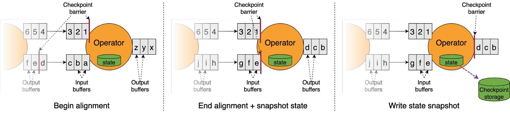

# 0000 Exactly-Once 与 End-To-End Exactly-Once
Exactly-Once 翻译成“精确一次”，是指：**一条数据影响且仅影响计算结果一次**。Exactly-Once 会成为一个讨论点主要是由于某些行业领域（如金融等）对数据准确性要求较高，而在分布式系统中实现 Exactly-Once 又有一定难度。

需要注意，Flink 应用内部的 Exactly-Once，与端到端 Exactly-Once 不同，不要混为一谈。端到端 Exactly-Once，指从 Source 到 Sink 全流程精确一次，需要满足更多的前置条件（后续详细说明）。举个例子，如果数据源不支持回放（比如类似迭代器或游标那样只能向前读取），那么如果在处理某一条数据的过程中任务故障重启了，重启之后消费的是下一条数据，这就出现了数据丢失。


# 0001 Flink 应用内部的 Exactly-Once

Flink 应用内部的 Exactly-Once，只需要启动 Checkpoint，并设置 `env.getCheckpointConfig().setCheckpointingMode(CheckpointingMode.EXACTLY_ONCE)`。

CheckpointingMode 只有两种：`EXACTLY_ONCE` 和 `AT_LEAST_ONCE`，背后受 Checkpoint Barrier 是否对齐的影响。
（CheckpointBarrierHandler 有两个具体的实现，即 BarrierTracker 和 BarrierBuffer，分别对应 AT_LEAST_ONCE 和 EXACTLY_ONCE 这两种模式。）

举例，在多 Source 的情况下，下游在做 Checkpoint 时如果不进行 Barrier 对齐，当 Source01、Source02 消费速度不一样时，假设 Source01 比较快，当 Checkpoint 开始时，系统在两个 Source 中同时生成 Barrier，流到下游算子的时候，Source01 中的 Barrier 先到了，这时候如果不进行 Barrier 对齐，算子会继续接受 Source01 的数据，并处理后输出到它的下游。稍后，Source02 中的 Barrier 到达该算子，触发 Checkpoint，则该 Checkpoint 保存此 Barrier 为止的状态，假如此时出现故障并自动重启恢复，程序会从该 Checkpoint 恢复，则算子中对 Source01 的数据就会出现重复处理，此时即为 `AT_LEAST_ONCE`。

下图演示 Barrier 对齐机制，可以看到，数字流在收到 Barrier 之后，实际上会进行等待，直到字母流也收到 Barrier：




# 0010 Flink 应用端到端的 Exactly-Once

Flink 应用端到端的"Exactly-Once"则需要 Source、Sink 的配合。具体来说：

1. **Source 需要支持回放**，也就是有机制可以记录消费点位，这样在故障恢复的时候可以从特定的点位开始重新消费。如果一个 Source 是一次性的，则不可能做到端到端的"Exactly-Once"。

2. **Sink 需要支持“两阶段提交（2PC，Two-Phase Commit）”**。在分布式系统中，两阶段提交是常用的用于实现分布式事务的方法，其基本流程是：

  - 1） 有一个协调者负责发起事务，并向所有参与者发送 prepare 消息，这里的所有参与者可以理解为分布式系统中的不同线程（可能位于同一节点上，也可能位于不同节点上）。
  - 2） 参与者将自己当前的事务数据写入到临时位置，此时并不提交数据。
  - 3） 参与者向协调者反馈，是否已经成功完成写入临时位置，此即 pre-commit。
  - 4） 当协调者收到所有参与者的成功反馈后，协调者下发 commit 消息。
  - 5） 参与者接收到 commit 命令，将自己的事务数据真正提交，也就是正式写入 Sink 所代表的外部存储，比如写入关系型数据库、文件、Kafka 等。
  - 6） 当参与者完成真正提交后，同样会反馈给协调者，协调者收到所有参与者的成功反馈后，完成整个事务。

对应到 Flink 中，协调者由 JobManager 担任，参与者则是各 TaskManager 上的 Sink。以下仍以基于文件的 Sink 为例：

  - 1） JobManager 充当协调者的角色，发起"Checkpoint"，触发 `snapshotState()->beginTransaction()`，创建新事务。
  - 2） 参与者将接收到的数据写入临时文件，这是在 invoke() 方法中实现的。
  - 3） 经过一定时间后，JobManager 发起新的一个"Checkpoint"，触发 `snapshotState()->preCommit()`，关闭临时文件，终止写入。随后"Checkpoint"完成，并通知 JobManager。
  - 4） 当 JobManager 收到所有节点"Checkpoint"成功的反馈后（相当于收到了所有事务 pre-commit 成功的反馈），JobManager 下发"Checkpoint"成功的消息，触发 `notifyCheckpointComplete()->commit()`。
  - 5） 在 commit() 中，用户将临时文件移到最终目录，完成真正的提交。
  - 6） 这里没有反馈，如有异常，会直接出错导致任务重启，并重新提交。

注：snapshotState() 既触发了当前任务的提交，也会触发新任务的创建，可参见下方具体的代码。


# 0011 Flink 2PC 源码
下面重点讲解一下两阶段提交的相关源码，TwoPhaseCommitSinkFunction.java@flink-1.11.0，重点关注以下几个核心方法，参见下方的中文注释：

- `notifyCheckpointComplete()`
- `snapshotState()`
- `initializeState()`

```java
/**
 * This is a recommended base class for all of the {@link SinkFunction} that intend to implement exactly-once semantic.
 * It does that by implementing two phase commit algorithm on top of the {@link CheckpointedFunction} and
 * {@link CheckpointListener}. User should provide custom {@code TXN} (transaction handle) and implement abstract
 * methods handling this transaction handle.
 *
 * @param <IN> Input type for {@link SinkFunction}.
 * @param <TXN> Transaction to store all of the information required to handle a transaction.
 * @param <CONTEXT> Context that will be shared across all invocations for the given {@link TwoPhaseCommitSinkFunction}
 *                 instance. Context is created once
 */
@PublicEvolving
public abstract class TwoPhaseCommitSinkFunction<IN, TXN, CONTEXT>
		extends RichSinkFunction<IN>
		implements CheckpointedFunction, CheckpointListener {

	private static final Logger LOG = LoggerFactory.getLogger(TwoPhaseCommitSinkFunction.class);

	protected final LinkedHashMap<Long, TransactionHolder<TXN>> pendingCommitTransactions = new LinkedHashMap<>();

	protected transient Optional<CONTEXT> userContext;

	protected transient ListState<State<TXN, CONTEXT>> state;

	private final Clock clock;

	private final ListStateDescriptor<State<TXN, CONTEXT>> stateDescriptor;

	private TransactionHolder<TXN> currentTransactionHolder;

	/**
	 * Specifies the maximum time a transaction should remain open.
	 */
	private long transactionTimeout = Long.MAX_VALUE;

	/**
	 * If true, any exception thrown in {@link #recoverAndCommit(Object)} will be caught instead of
	 * propagated.
	 */
	private boolean ignoreFailuresAfterTransactionTimeout;

	/**
	 * If a transaction's elapsed time reaches this percentage of the transactionTimeout, a warning
	 * message will be logged. Value must be in range [0,1]. Negative value disables warnings.
	 */
	private double transactionTimeoutWarningRatio = -1;

	/**
	 * Use default {@link ListStateDescriptor} for internal state serialization. Helpful utilities for using this
	 * constructor are {@link TypeInformation#of(Class)}, {@link org.apache.flink.api.common.typeinfo.TypeHint} and
	 * {@link TypeInformation#of(TypeHint)}. Example:
	 * <pre>
	 * {@code
	 * TwoPhaseCommitSinkFunction(TypeInformation.of(new TypeHint<State<TXN, CONTEXT>>() {}));
	 * }
	 * </pre>
	 *
	 * @param transactionSerializer {@link TypeSerializer} for the transaction type of this sink
	 * @param contextSerializer {@link TypeSerializer} for the context type of this sink
	 */
	public TwoPhaseCommitSinkFunction(
			TypeSerializer<TXN> transactionSerializer,
			TypeSerializer<CONTEXT> contextSerializer) {
		this(transactionSerializer, contextSerializer, Clock.systemUTC());
	}

	@VisibleForTesting
	TwoPhaseCommitSinkFunction(
		TypeSerializer<TXN> transactionSerializer,
		TypeSerializer<CONTEXT> contextSerializer,
		Clock clock) {
		this.stateDescriptor =
			new ListStateDescriptor<>(
				"state",
				new StateSerializer<>(transactionSerializer, contextSerializer));
		this.clock = clock;
	}

	protected Optional<CONTEXT> initializeUserContext() {
		return Optional.empty();
	}

	protected Optional<CONTEXT> getUserContext() {
		return userContext;
	}

	@Nullable
	protected TXN currentTransaction() {
		return currentTransactionHolder == null ? null : currentTransactionHolder.handle;
	}

	@Nonnull
	protected Stream<Map.Entry<Long, TXN>> pendingTransactions() {
		return pendingCommitTransactions.entrySet().stream()
			.map(e -> new AbstractMap.SimpleEntry<>(e.getKey(), e.getValue().handle));
	}

	// ------ methods that should be implemented in child class to support two phase commit algorithm ------

	/**
	 * Write value within a transaction.
	 */
	protected abstract void invoke(TXN transaction, IN value, Context context) throws Exception;

	/**
	 * Method that starts a new transaction.
	 *
	 * @return newly created transaction.
	 */
	protected abstract TXN beginTransaction() throws Exception;

	/**
	 * Pre commit previously created transaction. Pre commit must make all of the necessary steps to prepare the
	 * transaction for a commit that might happen in the future. After this point the transaction might still be
	 * aborted, but underlying implementation must ensure that commit calls on already pre committed transactions
	 * will always succeed.
	 *
	 * <p>Usually implementation involves flushing the data.
	 */
	protected abstract void preCommit(TXN transaction) throws Exception;

	/**
	 * Commit a pre-committed transaction. If this method fail, Flink application will be
	 * restarted and {@link TwoPhaseCommitSinkFunction#recoverAndCommit(Object)} will be called again for the
	 * same transaction.
	 */
	protected abstract void commit(TXN transaction);

	/**
	 * Invoked on recovered transactions after a failure. User implementation must ensure that this call will eventually
	 * succeed. If it fails, Flink application will be restarted and it will be invoked again. If it does not succeed
	 * eventually, a data loss will occur. Transactions will be recovered in an order in which they were created.
	 */
	protected void recoverAndCommit(TXN transaction) {
		commit(transaction);
	}

	/**
	 * Abort a transaction.
	 */
	protected abstract void abort(TXN transaction);

	/**
	 * Abort a transaction that was rejected by a coordinator after a failure.
	 */
	protected void recoverAndAbort(TXN transaction) {
		abort(transaction);
	}

	/**
	 * Callback for subclasses which is called after restoring (each) user context.
	 *
	 * @param handledTransactions
	 * 		transactions which were already committed or aborted and do not need further handling
	 */
	protected void finishRecoveringContext(Collection<TXN> handledTransactions) {
	}

	// ------ entry points for above methods implementing {@CheckPointedFunction} and {@CheckpointListener} ------


	/**
	 * This should not be implemented by subclasses.
	 */
	@Override
	public final void invoke(IN value) throws Exception {}

	@Override
	public final void invoke(
		IN value, Context context) throws Exception {
		invoke(currentTransactionHolder.handle, value, context);
	}

    // checkpoint完成之后，会触发此回调函数
	@Override
	public final void notifyCheckpointComplete(long checkpointId) throws Exception {
		// the following scenarios are possible here
		//
		//  (1) there is exactly one transaction from the latest checkpoint that
		//      was triggered and completed. That should be the common case.
		//      Simply commit that transaction in that case.
		//
		//  (2) there are multiple pending transactions because one previous
		//      checkpoint was skipped. That is a rare case, but can happen
		//      for example when:
		//
		//        - the master cannot persist the metadata of the last
		//          checkpoint (temporary outage in the storage system) but
		//          could persist a successive checkpoint (the one notified here)
		//
		//        - other tasks could not persist their status during
		//          the previous checkpoint, but did not trigger a failure because they
		//          could hold onto their state and could successfully persist it in
		//          a successive checkpoint (the one notified here)
		//
		//      In both cases, the prior checkpoint never reach a committed state, but
		//      this checkpoint is always expected to subsume the prior one and cover all
		//      changes since the last successful one. As a consequence, we need to commit
		//      all pending transactions.
		//
		//  (3) Multiple transactions are pending, but the checkpoint complete notification
		//      relates not to the latest. That is possible, because notification messages
		//      can be delayed (in an extreme case till arrive after a succeeding checkpoint
		//      was triggered) and because there can be concurrent overlapping checkpoints
		//      (a new one is started before the previous fully finished).
		//
		// ==> There should never be a case where we have no pending transaction here
		//
        //

        // 简单翻译上述几种可能的场景：
        // （1） 最常见的情况是，在checkpoint完成时，只有一个事务等待提交，这种情况下，简单地提交该事务即可。
        // （2） 当此前某个checkpoint被跳过，但又未触发失败，可能造成当前有多个等待提交的事务，这种情况下，需要把这些事务都提交。
        // （3） 当前存在多个未提交的事务，但checkpoint complete notification并不是最新的（通过比较checkpointId可知），
        //     也即最新一次的checkpoint的complete notification因为网络等原因延迟了，这种情况下忽略该事务。

		Iterator<Map.Entry<Long, TransactionHolder<TXN>>> pendingTransactionIterator = pendingCommitTransactions.entrySet().iterator();
		Throwable firstError = null;

		while (pendingTransactionIterator.hasNext()) {
			Map.Entry<Long, TransactionHolder<TXN>> entry = pendingTransactionIterator.next();
			Long pendingTransactionCheckpointId = entry.getKey();
			TransactionHolder<TXN> pendingTransaction = entry.getValue();
			if (pendingTransactionCheckpointId > checkpointId) {
				continue;
			}

			LOG.info("{} - checkpoint {} complete, committing transaction {} from checkpoint {}",
				name(), checkpointId, pendingTransaction, pendingTransactionCheckpointId);

			logWarningIfTimeoutAlmostReached(pendingTransaction);
			try {
				commit(pendingTransaction.handle);
			} catch (Throwable t) {
				if (firstError == null) {
					firstError = t;
				}
			}

			LOG.debug("{} - committed checkpoint transaction {}", name(), pendingTransaction);

			pendingTransactionIterator.remove();
		}

		if (firstError != null) {
			throw new FlinkRuntimeException("Committing one of transactions failed, logging first encountered failure",
				firstError);
		}
	}

	@Override
	public void notifyCheckpointAborted(long checkpointId) {
	}

    // checkpoint开始时，会触发此回调函数，在这个函数中核心做了3件事：
    // （1） 对当前事务，进行“两阶段提交”中的“预提交（pre-commit）”操作。
    // （2） 启动新事务。（checkpoint类似于一个切割点，需要pre-commit现有事务，同时为后续启动新事务）
    // （3） 将这两个事务的相关数据，存入state
	@Override
	public void snapshotState(FunctionSnapshotContext context) throws Exception {
		// this is like the pre-commit of a 2-phase-commit transaction
		// we are ready to commit and remember the transaction

		checkState(currentTransactionHolder != null, "bug: no transaction object when performing state snapshot");

		long checkpointId = context.getCheckpointId();
		LOG.debug("{} - checkpoint {} triggered, flushing transaction '{}'", name(), context.getCheckpointId(), currentTransactionHolder);

		preCommit(currentTransactionHolder.handle);
		pendingCommitTransactions.put(checkpointId, currentTransactionHolder);
		LOG.debug("{} - stored pending transactions {}", name(), pendingCommitTransactions);

		currentTransactionHolder = beginTransactionInternal();
		LOG.debug("{} - started new transaction '{}'", name(), currentTransactionHolder);

        // 状态中存储的是TransactionHolder对象，这个对象实际上是用户自定义TXN类的wrapper，通过源码可以看到，
        // 它相当于为TXN类加了一个事务启动时间字段（transactionStartTime）

		state.clear();
		state.add(new State<>(
			this.currentTransactionHolder,
			new ArrayList<>(pendingCommitTransactions.values()),
			userContext));
	}

    // 任务启动时（包括初次启动、重启），会触发该函数，其主要代码逻辑是在处理restore，
    // 其中getPendingCommitTransactions()是指从state中获取之前已经pre-commit的事务
    // 而getPendingTransaction()是指从state中获取之前刚创建的事务
	@Override
	public void initializeState(FunctionInitializationContext context) throws Exception {
		// when we are restoring state with pendingCommitTransactions, we don't really know whether the
		// transactions were already committed, or whether there was a failure between
		// completing the checkpoint on the master, and notifying the writer here.

		// (the common case is actually that is was already committed, the window
		// between the commit on the master and the notification here is very small)

		// it is possible to not have any transactions at all if there was a failure before
		// the first completed checkpoint, or in case of a scale-out event, where some of the
		// new task do not have and transactions assigned to check)

		// we can have more than one transaction to check in case of a scale-in event, or
		// for the reasons discussed in the 'notifyCheckpointComplete()' method.


        //简单翻译上述内容：

        //当我们进行restore时，我们无法确定pendingCommitTransactions中的事务是否已经提交。
        //我们是在snapshotState()方法，即checkpoint开始时，把pre-commit的事务保存到flink state中的。
        //当checkpoint成功后，需要由JM下发通知给各TM，有可能checkpoint完成了，但在JM消息下发的过程中任务失败了，导致没有走到事务commit这一步。

        //常见的情况是事务已经提交了，因为checkpoint成功与消息下发之间的时间间隔很小。

        //pendingCommitTransactions中也可能完全没有事务遗留，例如任务刚启动就失败了，连一个事务也没有完成。或者在集群进行了横向扩展，
        //部分新的TM并没有老的事务。

        //pendingCommitTransactions中也可能有多个事务，一种情况是集群进行了缩容，还有一些情况是上面'notifyCheckpointComplete()'中讨论过的。

		state = context.getOperatorStateStore().getListState(stateDescriptor);

		boolean recoveredUserContext = false;
		if (context.isRestored()) {
			LOG.info("{} - restoring state", name());
			for (State<TXN, CONTEXT> operatorState : state.get()) {
				userContext = operatorState.getContext();
				List<TransactionHolder<TXN>> recoveredTransactions = operatorState.getPendingCommitTransactions();
				List<TXN> handledTransactions = new ArrayList<>(recoveredTransactions.size() + 1);
				for (TransactionHolder<TXN> recoveredTransaction : recoveredTransactions) {
					// If this fails to succeed eventually, there is actually data loss
                    // 对于pre-commit的事务，调用此方法
                    // 由于我们无法确定此部分的事务是否被最终commit，因此这里只能再次进行了commit操作（具体commit的逻辑，是由用户自行实现）
                    
                    // 那么，如何解决重复提交的问题？
                    // 这里面实际上有一个隐含的条件，即我们在实现commit()方法时，需要手动确保其**幂等性**。
                    // 举一个基于文件的sink：
                    // （0） 实现一个TXN类，用于保存事务所需元数据，这里创建一个简单的可序列化类就可以，包含该事务所使用的临时目录和临时文件名，以及最终目标路径及文件名。
                    // （1） 实现beginTransaction()方法，该方法在任务启动或checkpoint开始时触发，这里我们需要创建临时目录和临时文件。
                    // （2） 实现invoke()方法，该方法为每一条进来的数据触发一次，这里我们需要将进来的数据写入临时文件。
                    // （3） 实现preCommit()方法，该方法在checkpoint开始时触发，这里我们需要关闭临时文件，不在往里写入数据。
                    // （4） 实现commit()方法，该方法在checkpoint完成并回调notifyCheckpointComplete()时触发，这里我们需要将临时文件移动到真正的目标目录，并删除临时文件。
                    // ……
                    // 这里第4步很容易保证幂等性，在commit()中，先判断是否存在对应的临时文件，如不存在则取消提交。当重复提交发生时，由于对应的临时文件已删除，因此不会提交。

					recoverAndCommitInternal(recoveredTransaction); 
					handledTransactions.add(recoveredTransaction.handle);
					LOG.info("{} committed recovered transaction {}", name(), recoveredTransaction);
				}

				{
					TXN transaction = operatorState.getPendingTransaction().handle;
                    // 对于新事务，调用此方法，实际上就是对事务进行abort（具体abort的逻辑，是由用户自行实现）
                    // 对于一个checkpoint后新创建的事务（该事务实际上是对该checkpoint所记录消费点位**之后**的数据），
                    // 可以直接进行abort，原因在于，当我们基于这一checkpoint进行restore时，source会基于checkpoint中对应的消费点位进行重放，
					recoverAndAbort(transaction); 
					handledTransactions.add(transaction);
					LOG.info("{} aborted recovered transaction {}", name(), operatorState.getPendingTransaction());
				}

				if (userContext.isPresent()) {
					finishRecoveringContext(handledTransactions);
					recoveredUserContext = true;
				}
			}
		}

		// if in restore we didn't get any userContext or we are initializing from scratch
		if (!recoveredUserContext) {
			LOG.info("{} - no state to restore", name());

			userContext = initializeUserContext();
		}
		this.pendingCommitTransactions.clear();

		currentTransactionHolder = beginTransactionInternal();
		LOG.debug("{} - started new transaction '{}'", name(), currentTransactionHolder);
	}

    …… …… ……
}
```
