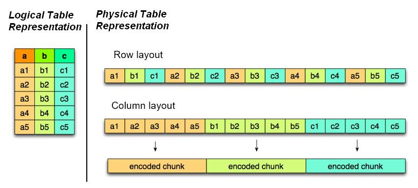
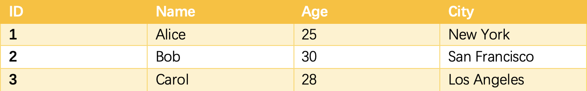
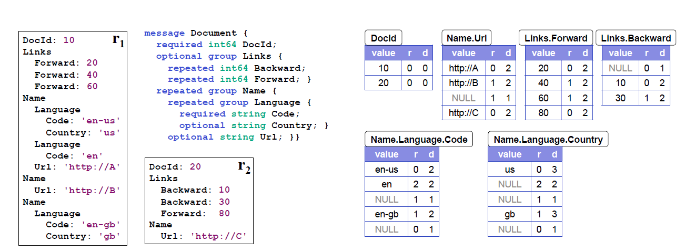

本文讨论列式存储的基本原理，并以 Google Dremel 论文中的示例，说明嵌套结构如何借助「重复级别」和「定义级别」重建。

# 列式存储



行式存储、列式存储，上图表示得很直观了。对于频繁进行单行操作的 OLTP 场景，行式存储较为适用。但面对数据分析场景，尤其是大数据下的分析场景，列式存储有一定的优势：

1. 查询效率优化：针对分析型场景中频繁访问少量列的特点，通过按列连续存储数据，仅需读取查询涉及的列，大幅减少 I/O 数据量。
2. 存储压缩增强：利用同一列内数据的高同质化特性，采用针对性压缩算法，显著提升压缩率，降低存储成本。

# 记录重建

使用列式存储，能想到的第一个问题就是，如何重建一行数据。

## 二维表

先从简单的开始，假设数据是二维表这种扁平结构，重建一行数据的原理其实也很简单。



假设我们需要查询 ID=2 的整行数据，即 `[2, "Bob", 30, "San Francisco"]`。

首先，我们先在 ID 列所在的文件中查找值为 2 的位置，其 position=1（从 0 开始）。那么，只要找出其他列中同样 position=1 的值，就可以重建该行数据。当然，在真正实现的时候，每一列的数据会分块存储，系统会存储每一块的元数据，如 start-position 和 end-position，这样你无需担心在定位 position=1_000_000 时需要从头遍历了。

## 嵌套结构

二维表这种结构显然不是大数据的全部，许多数据具有更为复杂的结构，例如嵌套结构、可选字段、数组字段等等。将复杂的嵌套结构扁平化，看起来是个很简单的工作：分别抽取每个字段的值，存入该字段对应的列文件中即可。但是如何重建该条数据，就比较麻烦了。业界主要是根据 Google Dremel 的相关论文来做的，这里我们就来看看 Google Dremel 是怎么做的。



关于 Google Dremel 的介绍，网上有很多，但在解析「重复级别」与「定义级别」等概念时，常常知其然而不知其所以然。这里我结合伪代码来解释这两个参数是如何工作的，以及为什么需要它们。

首先，我们来看一下一条记录的 schema 定义，熟悉 Google protobuf 的人会发现它非常相似。最外层是 message，里面的嵌套结构则是 group。每个字段有 3 种修饰词：required 指这个字段必须有值，optional 指可以没有值，repeated 指这是一个列表（也可以没有值）。

重点来了，介绍一下 r（即「重复级别」）和 d（即「定义级别」）：

- 重复级别（Repetition Level）：表示在该字段路径上哪个节点进行了重复（at what repeated field in the field's path the value has repeated）。
- 定义级别（Definition Level）：表示该字段路径上有多少可选的字段实际进行了定义（how many fields in p that could be undefined, because they are optional or repeated, are actually present）。

有点抽象。看不懂没关系，我们举例来说明。

首先，我们看图中右侧的 DocId，r=0。根据规定，r=0 表示一条新记录，所以如果遍历 DocId 这一列，我们会得到两条新记录，用伪代码表示：

```java
Document doc1 = new Document(10)
Document doc2 = new Document(20)
```

接下来，我们以 Name.Language.Code 来讲解，看看遍历右侧 Name.Language.Code 这一列数据时，如何才能将数据并入我们刚刚创建出来的 doc1、doc2 中。

该列的第一条数据，r=0。根据规定，这是属于第一条记录（即 doc1）的第一个 code，那么我们就为 doc1 初始化一个 Code，伪代码表示：

```java
doc1.Name[0]=new Name()
doc1.Name[0].Language[0]=new Language()
doc1.Name[0].Language[0].Code="en-us"
```

该列的第二条数据，r=2。首先，非 0 表示这不是一条新记录，那么它和上一条一样，都属于 doc1。由于 Name 与 Language 都是 repeated 字段，因此就有两种情况：

```java
doc1.Name[0].Language[1]=new Language() // 旧的既有的 Name
doc1.Name[0].Language[1].Code="en"
```

或者：

```java
doc1.Name[1]=new Name() // 新的 Name
doc1.Name[1].Language[0]=new Language()
doc1.Name[1].Language[0].Code="en"
```

那么，是哪一种呢？这个时候就需要借助 r=2 来判断了：它表示在该字段路径（即 Name.Language.Code）上，第几个 repeated 字段出现重复。注意，这里的「第几个」是从 1 开始的，不是从 0 开始，因为 r=0 有特殊含义。路径中，Name 是第 1 个 repeated 字段，Language 是第 2 个 repeated 字段，因此这里 r=2 就表示是 Language 出现重复了，因此是上述伪代码中的第一种。

该列的第三条数据，value=NULL，r=1。根据上面的解释，r=1 表示 Name 出现重复了，这里也有两种情况：

```java
doc1.Name[1]=new Name()
doc1.Name[1].Language[0]=NULL
```

或者：

```java
doc1.Name[1]=new Name()
doc1.Name[1].Language[0]=new Language()
doc1.Name[1].Language[0].Code=NULL
```

这里就要借助另外一个参数，d=1：它表示在该字段路径（即 Name.Language.Code）上，有几个 repeated/optional 字段是有值的。这里的 d=1 就表示有一个 repeated/optional 字段有值，那按嵌套顺序只能是 Name 有值，而其下的 Language 没有值，即伪代码中的第一种。

那么，现在的问题是，有必要存储一个 NULL 吗？

对于 r=0 的情况，比较好理解。我们以右侧 Links.Backward 为例：如果不保存第一条这个 NULL 数据，那么后两条数据会被归入 doc1，而不是 doc2。

对于 r 非零的情况，稍微复杂一点。我们结合 Name.Url 和 Name.Language.Code 来解释，假设现在我们把右侧这两个列里的 NULL 都去掉，看看会发生什么。

我们遍历 Name.Url，会得到这样的结果：

```java
doc1.Name[0].Url="http://A"
doc1.Name[1].Url="http://B"
doc2.Name[0].Url="http://C"
```

看着没什么问题。接着我们遍历 Name.Language.Code：

```java
doc1.Name[0].Language[0].Code="en-us"
doc1.Name[0].Language[1].Code="en"
doc1.Name[1].Language[0].Code="en-gb"
```

看出问题了吗？doc1.Name[1] 出错了："http://B" 和 "en-gb" 被放到了一个 Name 下。

所以，保存 NULL 值相当于一个占位符，可以避免类似的错位情况发生。

# Protobuf？

前面我们看到了，Dremel 中数据 schema 的定义与 Protobuf 的定义方式十分相似（而 Protobuf 数据在京东广告算法数据中大量使用）。那么，Protobuf 数据能不能使用列式存储呢？

首先，Protobuf 仅仅是一个序列化库，项目中并不包含相对应的支持列式存储的文件格式，因此 Protobuf 数据无法直接进行列式存储。

不过，有间接的方法。例如借助开源项目 [parquet-protobuf](https://github.com/apache/parquet-java/tree/master/parquet-protobuf)，它实际上是将 Protobuf 的 schema 映射到 Parquet 的 schema（由于二者非常接近，所以容易完成），然后将每一条 Protobuf 的 Message 转换成 Parquet 的 Message 并写出。（补充一下，Apache Parquet 是 Google Dremel 论文中描述的内部列存格式的开源实现，是目前比较常用的列式存储文件格式，计算引擎如 Spark 等对它也支持得很好。）

借助该项目，通过一个简单的 Spark 程序，就可以将存储在 SequenceFile 中的 Protobuf 数据转换成 Parquet 文件格式写出。写完之后，通过 spark-shell 简单看一下，schema 被成功映射，数据被成功转换。

```scala
scala> val df = spark.read.parquet("hdfs://foo/bar/huangmaoyang/protobuf_to_parquet/part-r-00000.parquet");
scala> df.printSchema
root
 |-- searchLogInfo: struct (nullable = true)
 |    |-- sid: string (nullable = true)
 |    |-- day: long (nullable = true)
 |    |-- pos_id: string (nullable = true)
 |    |-- ad_traffic_type: integer (nullable = true)
 |    |-- retrieval_type: integer (nullable = true)
 |    |-- keyword: string (nullable = true)
 |    |-- ad_spread_type: integer (nullable = true)
 |    |-- ad_msg_info_extra: array (nullable = true)
 |    |    |-- element: struct (containsNull = true)
 |    |    |    |-- act_price: double (nullable = true)
 |    |    |    |-- ad_group_id: long (nullable = true)
 |    |    |    |-- ad_plan_id: long (nullable = true)
 |    |    |    |-- ctr_value: double (nullable = true)
 |    |    |    |-- bid_price: double (nullable = true)
 |    |    |    |-- ad_q: float (nullable = true)
 |    |    |    |-- sku_id: long (nullable = true)
 |    |    |    |-- automated_bidding_type: long (nullable = true)
 |    |-- slot_info: array (nullable = true)
 |    |    |-- element: struct (containsNull = true)
 |    |    |    |-- ad_show_pos: integer (nullable = true)
 |    |-- simulator_replay_tag: string (nullable = true)
 |-- impressLogInfo: array (nullable = true)
 |    |-- element: struct (containsNull = true)
 |    |    |-- sid: string (nullable = true)
 |    |    |-- pos_id: integer (nullable = true)
 |    |    |-- sku_id: long (nullable = true)
 |    |    |-- retrieval_type: integer (nullable = true)
  ......
```

```scala
scala> df.createOrReplaceTempView("t1")
scala> spark.sql("select searchLogInfo.sid, searchLogInfo.pos_id from t1 limit 10").show
+--------------------+------+
|                 sid|pos_id|
+--------------------+------+
|e19e2f28-ac7e-437...|   633|
|66ef5003-40af-439...|   633|
|b2b8b1be-41ad-42f...|   633|
|df164c73-e060-432...|   633|
|b3a8010d-bb43-49a...|   633|
|21c4fa89-3a10-4e6...|   633|
|a6bb98db-8128-4bd...|   633|
|21c4fa89-3a10-4e6...|   633|
|dabd3d63-c842-415...|   633|
|085bd5a8-cc52-4ad...|   633|
+--------------------+------+
```
