本文以 Apache Spark 项目为例，介绍如何成为顶级开源社区的 Contributor，包括准备工作、代码编译、起步练手、进入正题，以及最后你能得到什么。

Apache Spark 大家应该都有所耳闻，摘录一段官网上关于该项目的介绍：

> The most widely-used engine for scalable computing.
> Thousands of companies, including 80% of the Fortune 500, use Apache Spark™.
> Over 2,000 contributors to the open source project from industry and academia.

# 0001 准备工作

1. 还不错的 Java/Scala 水平。
2. 还不错的英语水平。
3. 还不错的 Apache Spark 使用熟练度／源码熟悉度。
4. 一个 GitHub 账号。
5. 一个 Apache JIRA 账号。
6. 科学上网（Optional，当访问 GitHub/JIRA/Maven Repo 不太稳定时可以考虑）。

对 JIRA 做一个简单的补充：JIRA 是一个需求／BUG 管理系统，用于追踪需求／BUG 的生命周期。Apache 基金会下有许多项目，所有这些项目的需求开发、BUG Fixing，都是在 Apache JIRA 中进行管理的。

打开 [Apache JIRA](https://issues.apache.org/jira/issues/)，可以看到形如下图的界面：

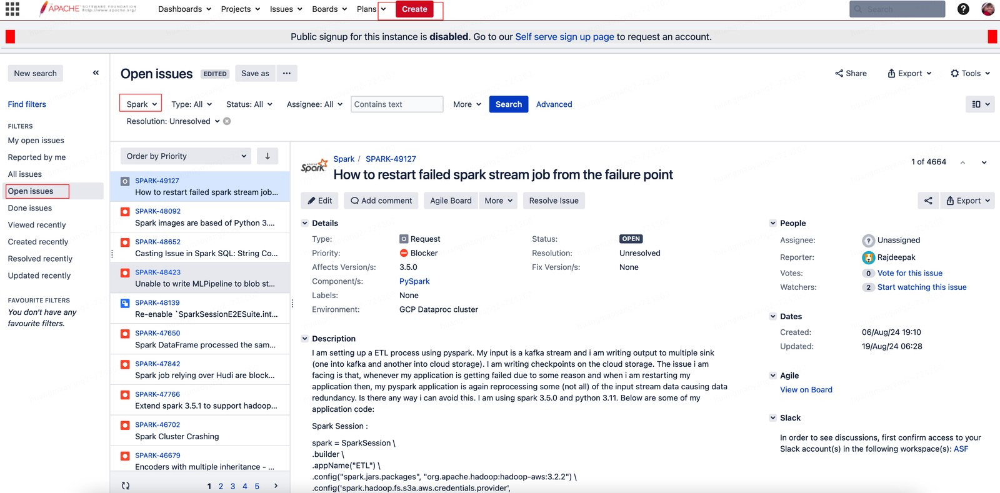

选择「Open issues」，项目选择「Spark」，就可以看到目前正在等待处理的需求／BUG 列表了，可以挑选其中你感兴趣的进行研究。如果在平时使用 Spark 的过程中发现 Bug，可以点击上方的「Create」按钮给社区提交一个 JIRA。

Apache JIRA 上，如果你对某个 JIRA 感兴趣，是没办法直接将某个 JIRA 分配给自己，只有 Apache Spark PMC（Project Management Committee）成员才有权限，不过你可以先在 JIRA 下留言表示自己有兴趣，或者直接提交一个 PR，这样一般就不会被其他人拿走了。

# 0010 代码编译

1. 登录 [GitHub](https://github.com/)，搜索「spark」，选择左侧的「Repositories（仓库）」，排在第一个的就是 Apache Spark 代码仓库。

   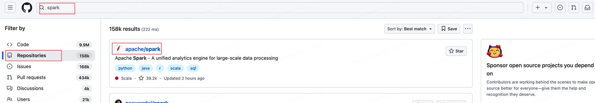

2. Fork 仓库到你名下。假设你的 GitHub 账户名称是 johndoe，那么 fork 之后，你就有了一个 `https://github.com/johndoe/spark` 的仓库。

   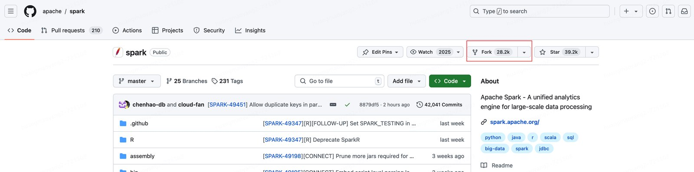

   之后，如果需要从 Apache Spark 仓库同步代码，点击「Sync Fork」按钮即可。

   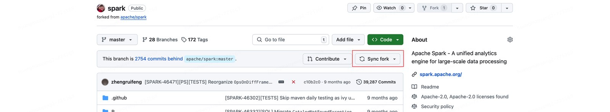

3. Clone 代码到你本地。

```shell
git clone https://github.com/johndoe/spark.git
```

4. 首次编译。

```shell
# 为 Maven 设置参数
export MAVEN_OPTS="-Xss64m -Xmx2g -XX:ReservedCodeCacheSize=1g"
# 1) 建议使用 spark 代码中自带的 maven，避免因版本不同导致的问题。
# 2) 编译过程通常时间不会太短，我本机（i7 + 16G）编译时长一般在 20-30 分钟。
# 3) 如果出现 Maven 依赖无法下载的问题，考虑科学上网或者切换到国内的 Maven 源。
./build/mvn -DskipTests clean install
```

# 0011 起步练手

如何找到一个适合新手上手的 Bug，这是许多人遇到的第一个障碍。临时去 Apache JIRA 中找一个来练手可能是比较困难的，建议平时在使用 Apache Spark 过程中遇到问题，可以翻翻 Apache Spark 源码，有助于你发现问题。

许多人第一次会选择文档类的改动，例如文档中的错误表达、拼写错误等等，这些错误相对好找，改动起来也没有风险，是一个不错的选择。我在上手的时候，没有去找文档类的，选择了一个编译类的错误，难度也不高。

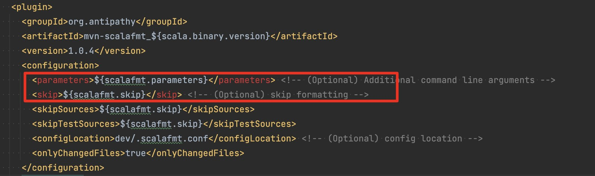

具体的流程是：先在本地复现问题、定位到出错的配置项，联系插件作者确认后再修改配置，最后按规范提交改动。下面介绍一下提交改动的过程：

1. 首先在 Apache JIRA 系统中为此创建一个 JIRA。

   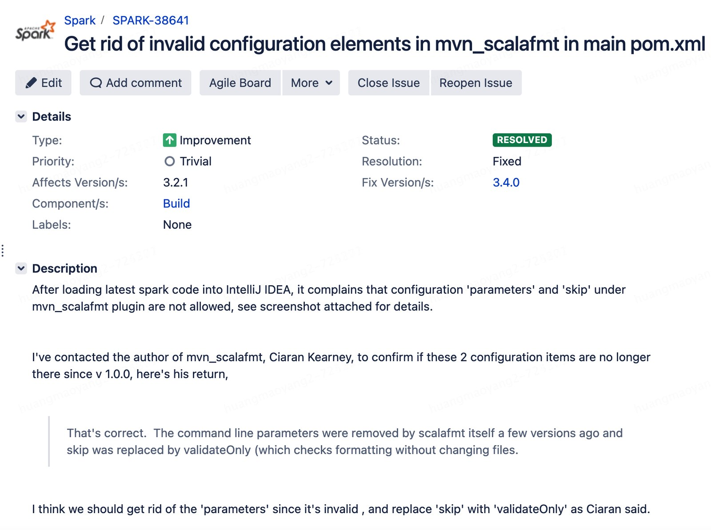

2. 启用 GitHub Action。它的作用是在你提交或更新 PR（pull request）时，可以在 GitHub 上自动触发编译和单元测试。

   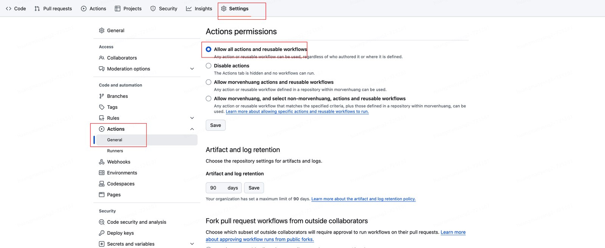

3. 在本地基于最新的 master 分支，创建一个新分支，分支的名称使用你创建的 JIRA 号，形如：SPARK-12345。
4. 邮件联系出问题的 scalafmt 插件的作者，得到确认后，对配置项进行了相应的修改。
5. 提交代码到 GitHub。
6. 创建 PR。注意 PR 的标题和描述都有格式要求。标题有两个前缀：[JIRA 号] 和 [模块]，例如：`[SPARK-38641][BUILD] Get rid of invalid configuration elements in mvn_scalafmt in main pom.xml`；描述部分则包含 5 项内容，这在创建时会自动生成模板让你填写。

   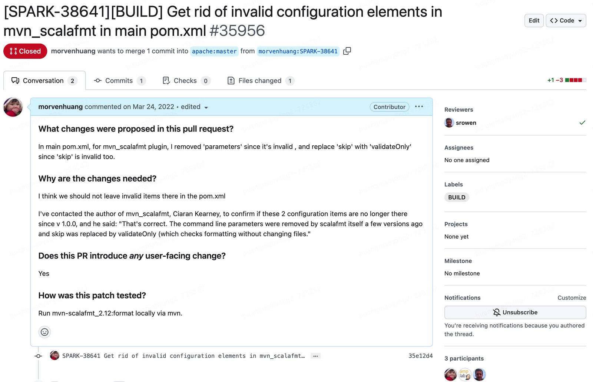

提交 PR 之后，GitHub Action 就自动开始编译和单元测试，通常需要几个小时时间，期间你需要关注一下是否出现失败，如果有失败就需要解决，可以查看 GitHub Action 页面下失败的 workflow 的日志来定位错误。

同时，提交 PR 之后，JIRA 页面也会自动关联上这个 PR。

7. GitHub Action 完成之后，会有 PMC 来 review 代码，如果他们觉得没有问题，就会将你的代码 merge 到 master 上，这样，整个流程就完成了。对于像这样比较简单的改动，一般 2-3 天就可以被 merge 到主分支上。

# 0100 进入正题

经过上面的练手，就要进入正题，找一些真正需要代码改动的 Bug 来处理了。在这之前，首先需要对 Apache Spark 的源码有一定的了解，至少是对于需要改动的 module 有一定的了解。

如果你有较长时间的使用 Spark 的经验，其实还是比较容易发现 Bug 的。例如，下面是一个我自己提报、自己修改的关于 Spark SQL 的 Bug。

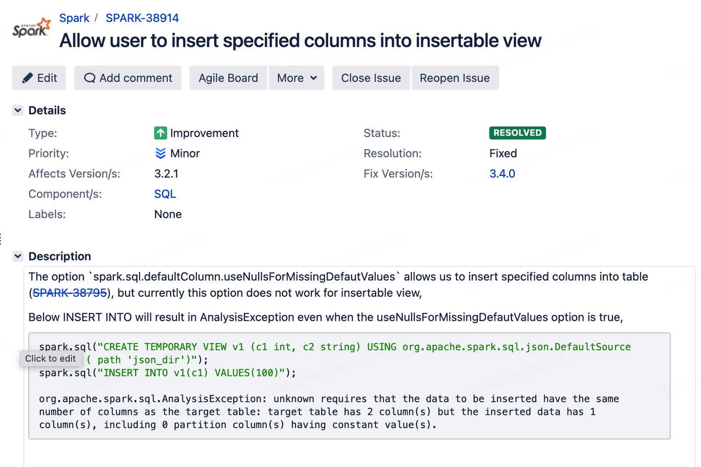

1. 首先，基于经验找到是哪个 module 的代码问题。与 SQL 语句／语法相关的问题，通常在 sql module 中。
2. 修改代码。
3. 添加单元测试。绝大多数的代码改动，都要求提供新的单元测试。
4. 本地测试。即先在本地跑通 sql module 下的所有单元测试。
5. 提交 PR。

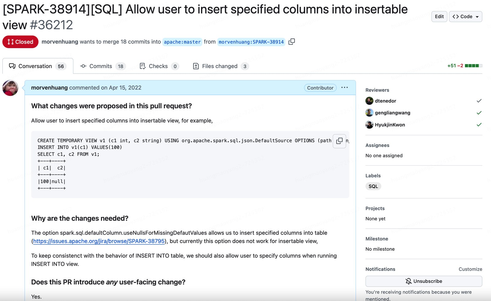

整体的流程与练手例子中的差不多，有几点区别：

1. 整体的持续时间会更长，上面例子中的 PR 的 review 时间跨度超过 20 天，一共有 3 位 PMC 参与 review。
2. PMC 对代码质量和细节是比较严格的，可能会有多轮的沟通，在我的这个例子中，我前后做了 10 几次 commit。
3. 你在改动的同时，可能又会有其他人新的改动被 merge 进来，可能会导致一些新的问题。
4. GitHub Action 偶尔会发疯，这个时候可以推一个空的 commit 到 GitHub 来重新触发 GitHub Action。

```shell
git commit --allow-empty -m "trigger GitHub actions"
git push
```

# 0101 你将得到

1. 经受考验的耐心
2. 有手就行的信心
3. 对 Apache Spark 源码更好的认知
4. 一枚平平无奇的 GitHub Pull Shark 图标

   

5. 以及，你的名字被列在 Apache Spark 相应版本的 Release Note 里

   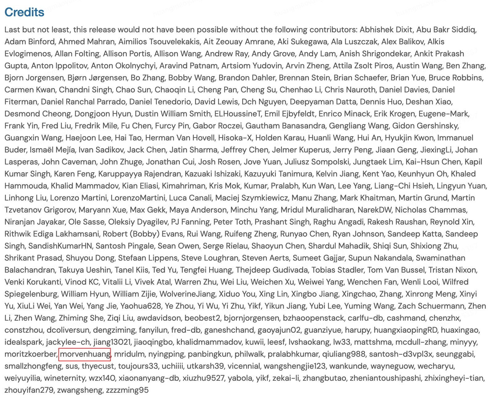
