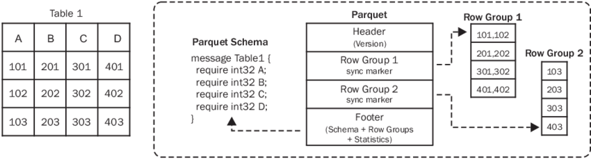
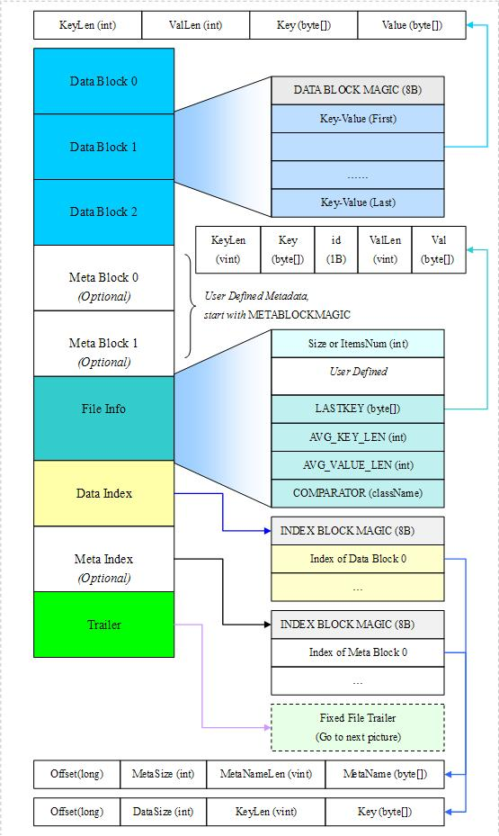
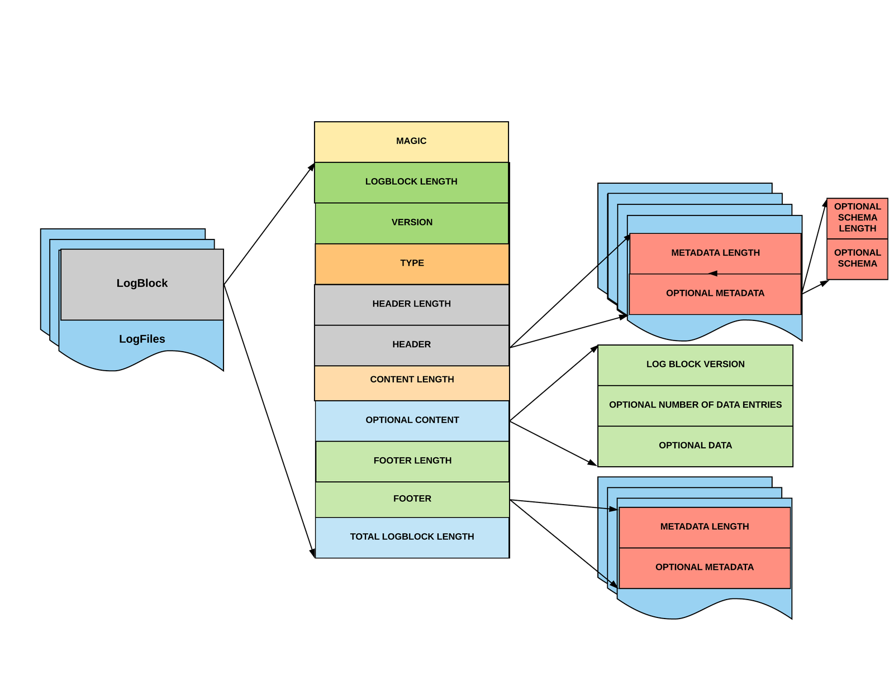

在大数据架构的演进中，文件格式的选择直接影响着数据存储效率、查询性能。作为数据湖仓（Data Lakehouse）的典型实现，Apache Hudi 在设计上集成了多种文件格式，各自契合不同的需求。这里以 Hudi 为入口，介绍几种常见大数据文件格式在 Hudi 架构中的应用，并进一步对各文件格式的设计理念做一些延伸探讨，希望对大家有所帮助。

# 0000 Hudi 中的文件格式
这是一张 COW 表的数据目录，可以看到使用的是 Parquet 文件格式：
```log
hdfs://foobar2:9000/hudi02/test_1/demo_cow/.hoodie
hdfs://foobar2:9000/hudi02/test_1/demo_cow/.hoodie_partition_metadata
hdfs://foobar2:9000/hudi02/test_1/demo_cow/0b224eef-7e8a-4dc1-b7e3-359328641b30-0_9-21-0_20251203154553710.parquet
```

这是一张 MOR 表的数据目录，可以看到 base file 仍然使用 Parquet 文件格式，而 log file 使用 Hudi 原生 log 文件格式：
```log
hdfs://foobar2:9000/hudi02/purchase_mor2/purchase_date=2025-01-01/.8f001521-7825-4ecf-8ff9-a4f2591daa14-0_20251212161222437.log.1_0-63-117
hdfs://foobar2:9000/hudi02/purchase_mor2/purchase_date=2025-01-01/.hoodie_partition_metadata
hdfs://foobar2:9000/hudi02/purchase_mor2/purchase_date=2025-01-01/8f001521-7825-4ecf-8ff9-a4f2591daa14-0_1-21-23_20251212151007075.parquet
```

这是一张 MOR 表的 record index 目录，可以看到使用的是 HFile 文件格式：
```log
hdfs://foobar2:9000/hudi02/purchase_mor2/.hoodie/metadata/record_index/.hoodie_partition_metadata
hdfs://foobar2:9000/hudi02/purchase_mor2/.hoodie/metadata/record_index/record-index-0000-0_0-5-26_00000000000000003.hfile
hdfs://foobar2:9000/hudi02/purchase_mor2/.hoodie/metadata/record_index/record-index-0001-0_1-5-27_00000000000000003.hfile
```

# 0001 Parquet
在数据湖（Data Lake）/数据湖仓（Data Lakehouse）领域，不论是 Hudi，还是 Iceberg，还是 Delta Lake，默认都使用 Parquet 作为其数据文件格式。



从图中可以看出，其数据按 Row Group（RG）组织，每个 RG 包含多行，每个 RG 内的数据按列存储（即同一列的数据连续存储在一起）。Parquet 作为典型的列式存储格式，核心的优势我觉得官方概括得很好：
> Apache Parquet: column-oriented data file format designed for efficient data storage and retrieval.

- 列存将同一列的数据连续存储，当查询只涉及少数列时，I/O 系统可以仅读取所需的列块，跳过无关列，从而大幅减少 I/O 吞吐量和内存占用。
- 同一列的数据类型和数值范围高度相似，这使得列存能够使用针对性的编码和压缩算法，获得远高于行存的压缩比。这将降低存储成本与网络及磁盘 IO。
- 与 Spark/Presto 等生态深度兼容，这些计算引擎面对 Parquet 时可以原生支持谓词下推、字段裁剪等查询优化。

Parquet 以高效存储和快速查询为目的，很契合 Hudi 等数据湖/数据湖仓的设计目标。

这里也展开说一下关于 Parquet/列存的几个迷思：

- “列存”可能令人会望文生义，以为不同列的数据存储在不同的文件中，因此进一步认为新增列或者删除列的成本较低。实际上，根据上面的图示，并不是把列分文件存储，而只是在 RG 粒度内按列存储。因此，如果执行「新增一列并填充数据」这样的操作，实际上会导致覆写该表的所有数据文件。
- 使用 Spark 的同学可能都在写入数据时用过 Append 模式，由此可能会认为 Parquet 是可追加的（appendable），实际上 Parquet 的追加只是理论上可行，实际上通常没有人这么做，因为追加 RG 会涉及到挪动文件 footer，而且需要更新 footer 中的统计信息，这会大幅影响写入效率。
- Parquet 似乎是按照 RG 定长分割，由此有人会认为 Parquet 可以原地更新（in-place update）。但实际上，Parquet 的 RG 虽然可以设置大小（如默认的 128MB），但这实际上是一个约数，这涉及到记录的完整性与压缩的不可预测性，所以不可能所有的 RG 都是精确的 128MB，因此 Parquet 不是定长分割文件，没有办法原地更新。所以，以 COW 表为例，如果你更新某一条记录，该记录所在的数据文件大小 1GB，则需要覆写 1GB 的数据。因此，如果存在较多更新，应该使用 MOR 表。

# 0010 HFile
Hudi 中的索引数据，使用的是 HFile 文件格式，这是源自 HBase 的一种数据文件格式。



HFile 是一种 KV 存储，每对 key-value 存储在一起。HFile 具有很高的点查性能。

文件是按块（block）组织，块内的数据是按 key 有序的，整个文件的数据也是按 key 有序的。另外，与其他多数大数据文件格式不同，HFile 还额外包含了 Bloom Filter 以及块索引。

在点查的过程中，首先利用 Bloom Filter 跳过完全不可能有目标 key 的 HFile 文件。

随后，会利用块索引。HFile 的块索引中会存储各个块的首 key，并指出该块在文件中的位置（偏移量），及块大小。由于数据都是有序的，因此在文件中定位数据块的过程，可以使用二分查找。同样，在块内定位具体某一个 key 的时候，也可以使用二分查找。

同样展开说说可能造成混淆/困惑的几个点：

- HFile 文件的块大小同样可以设置，但同样也是一个约数，毕竟每个块中必须完整存储若干个 kv，再加上块内同样要进行压缩，不可能正好是某个大小。

- HFile 会很自然地让人联想到 HBase，进而认为 Hudi 索引数据读写使用的也是 LSM Tree 机制。实际上没有，Hudi 只是使用了 HFile 这种文件格式，因为其高效的点查性能契合 Hudi 索引的需求。

# 0011 Hudi 原生 log 文件格式
Hudi 的 delta log 使用的是自定义的 Hudi Log File Format（为方便起见，后称：HLF）。



HLF 的几个优势：

- 良好的可追加性：我们知道 MOR 追求的是快速写（因此会损失一定的读性能，即所谓的读放大），因此 log 文件追求写性能，从图中可以看出，HLF 在文件级别，采用简单的分块（LogBlock）设计，使其可以方便地追加块，利用磁盘顺序写来提高写性能，同时又没有文件级别的元数据/统计信息需要更新。

- 块级别自描述：从图中可以看出，HLF 的块内结构要比 Parquet 或 HFile 复杂的多，每一个 block 都是自描述的，块内部包含关于自身的完备元数据，像其中的 Header，就会保存数据写入时的 Schema，这就意味着，同一个文件的不同块，可以使用不同的 Schema，即 HLF 从块粒度支持了 Schema 演进，对比像 Avro 文件格式，是在文件头存储 Schema，即它是从文件粒度支持 Schema 演进。

- 便于 Merge/Compaction：log 数据在读取时要 Merge、最终还要被 Compaction，因此 HLF 需要充分契合 Merge/Compaction 操作。例如 Type 与 Header 的存在，可以方便 Merge/Compaction 时快速跳过无关的块。
而 content 部分默认使用 Avro 序列化，这是一种行式序列化，契合 log 数据中的行级变更。

对于 HLF，很多人可能都会提出一个问题：除了默认使用 Avro 之外，为什么 log content 的序列化还支持 Parquet、HFile？按理说 Avro 这种按行组织的数据，且可以高速 append，是最贴近 Hudi Log 的需求序列化方案。

个人觉得，支持 Parquet 序列化可能是针对 Compaction 间隔时间较长，同时伴随频繁读取少数列的操作，这种场景下，log content 使用 Parquet 序列化可以有效利用列存的优势。

类似的，HFile 序列化可能是针对 Compaction 间隔时间较长，同时伴随频繁的点查操作的场景。使用 HFile 序列化还有一个问题，它本身是一种 Key-Value 格式，这意味着一行数据需要序列化后放到 Value 中，这里，Hudi 选择哪种序列化呢？答案是 Avro，这也好理解——情况已经够复杂了，就不要在 Value 的序列化上再增加复杂度了。

# 0100 最后
> For every complex problem there is an answer that is clear, simple, and wrong.

在大数据生态中，我们会看到五花八门的文件格式，其中耳熟能详的有：Parquet、Avro、ORC、SequenceFile、HFile 等等，这些文件格式各有不同的设计理念，在读、写、压缩、点查、Schema 演进等等性能方面各有侧重，这从 Apache Hudi 的实践中可见一斑——没有完全通用的文件格式，需选择契合场景的文件格式，有时甚至需要自定义自己的文件格式。
