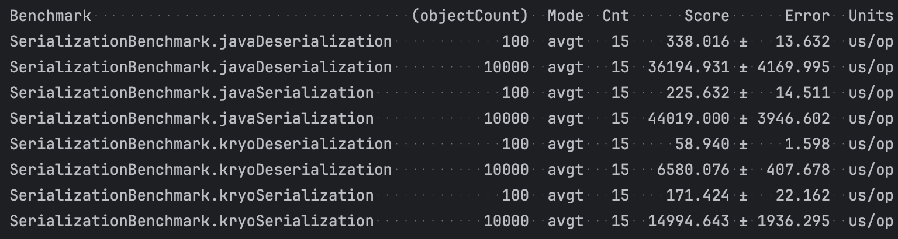

# 前言

熟悉 Apache Flink 的同学知道，开发者可以通过 `ExecutionConfig.registerTypeWithKryoSerializer()` 方法明确指定某些类型使用 Kryo（音：cry-o）进行序列化。实际上不仅如此：除了原始类型和 POJO 类，大量类型默认就使用 Kryo 序列化与反序列化；甚至对于 POJO 类，如果不能顺利使用自带的 PojoSerializer，回退的第一备胎也是 Kryo。

对于 Apache Spark，从 2.0.0 版本开始，简单类型的 RDD 在 shuffle 过程中也已默认使用 Kryo 进行序列化；开发者还可以通过 `SparkConf.set("spark.serializer", "org.apache.spark.serializer.KryoSerializer")` 配置全局使用 Kryo。

# 简介

Java 原生序列化机制只需实现 Serializable 接口即可，使用简单，但其性能常常被人诟病：序列化后的字节流体积大、性能低下，在海量数据的情况下缺点更为突出。所以，出现了许多不同的序列化方案，例如常见的 Avro、Protobuf 等，也包括 Kryo。

与 Java 原生序列化相比，这些第三方序列化方案在速度和序列化体积方面具有显著优势，其核心优化之一在于对数据布局的改进。它们普遍采用了变长数值类型编码方式，将 Java 语言中固定长度的数值类型——如 int（固定 32 位）和 long（固定 64 位）——根据实际数值大小，以更少的位数进行表示。由于实际应用场景中使用的数值大多处于较小范围，往往并不需要完整的 32 位或 64 位存储空间，因此通过变长编码技术，可大幅减少序列化后的数据体积，从而提升传输效率并降低存储开销。

同样作为第三方序列化库，Kryo 与 Protobuf 等的区别在于：Kryo 一般只被用于 Java 语言，而 Protobuf 支持跨语言，因此后者使用起来比 Kryo 更加复杂，例如需要预定义 schema（即 .proto 文件），并根据 schema 生成目标语言下的 schema 类，而 Kryo 则不需要预定义 schema。

# 使用

## 直接使用

```xml
<dependency>
	<groupId>com.esotericsoftware</groupId>
	<artifactId>kryo</artifactId>
	<version>5.5.0</version>
</dependency>
```

```java
Kryo kryo = new Kryo();
kryo.register(User.class);
kryo.register(ArrayList.class);
List<User> list = new ArrayList<>();
for (int i = 0; i < 3; i++) {
    list.add(new User("User_" + i, i % 100, "user" + i + "@example.com"));
}

ByteArrayOutputStream outputStream = new ByteArrayOutputStream();
Output output = new Output(outputStream);
kryo.writeObject(output, list); // 执行序列化
output.close();
byte[] serializedBytes = outputStream.toByteArray();
System.out.println("序列化成功，字节数: " + serializedBytes.length);

ByteArrayInputStream inputStream = new ByteArrayInputStream(serializedBytes);
Input input = new Input(inputStream);
List<User> de = kryo.readObject(input, ArrayList.class);
input.close();
System.out.println("反序列化成功，List长度: " + de.size());
```

## 在 Apache Flink 中使用

Flink 中非 POJO 类型已经默认使用 Kryo 了，你不需要进行任何额外的操作，Kryo 会用通用序列化器来处理这些类型。不过在一些情况下，Kryo 的通用序列化器可能不是最优的，这个时候，开发者可以通过类似以下代码为某一类型指定特定的序列化器。

例如，下面的例子中，`ArchiveLogInfo` 实际是一个 Protobuf 类型。如果使用 Kryo 的通用序列化器，它会按常规类型来处理它，这不是最高效的，所以这里给它指定了 `ProtobufSerializer` 序列化器。它是源自 Twitter 的一个实现，内部实际上利用了 Protobuf 自身的 `.toByteArray()` 方法和 `.parseFrom(byte[])` 方法进行高效的序列化与反序列化。

```xml
<dependency>
    <groupId>com.twitter</groupId>
    <artifactId>chill-protobuf</artifactId>
    <version>0.7.6</version>
    <exclusions>
        <exclusion>
            <groupId>com.esotericsoftware.kryo</groupId>
            <artifactId>kryo</artifactId>
        </exclusion>
    </exclusions>
</dependency>
```

```java
StreamExecutionEnvironment env = StreamExecutionEnvironment.getExecutionEnvironment();
env.getConfig().registerTypeWithKryoSerializer(ArchiveLogInfo.class, ProtobufSerializer.class);
```

## 在 Apache Spark 中使用

正如前面所说，简单类型的 RDD 在 shuffle 过程中默认使用 Kryo 进行序列化；如果想要完全使用 Kryo，需要设置如下选项：

```java
SparkConf.set("spark.serializer", "org.apache.spark.serializer.KryoSerializer")
```

注意，一旦将 `spark.serializer` 设置成了 `org.apache.spark.serializer.KryoSerializer`，Spark 就会全局使用且仅使用 Kryo，即便序列化失败，也不会回退到 Java 原生序列化。

Spark 中与 Kryo 有关的配置还有一个：

```java
SparkConf.set("spark.kryo.registrationRequired", "true")
```

这个选项不是用于控制是否使用 Kryo，而是用于控制是否强制进行类型注册。所谓注册，在 Spark 中是通过 `SparkConf.registerKryoClasses(User.class)` 来完成的。当你把 `spark.kryo.registrationRequired` 设置为 true，却没有调用 `registerKryoClasses()` 对类进行注册时，Kryo 会直接抛出异常。

这就引出几个问题：

a. 为什么 Kryo 建议对类进行注册？主要是因为性能。在 Kryo 的序列化机制中，当**第一次**遇到某个类型的对象时，它在序列化时会将这个类型的完整类名（如 `com.foo.bar.User`）写入序列化后的数据中，完整类名通常有十几个甚至几十个字符，这就带来额外的开销。如果你对该类型进行注册，那么它会被分配一个整型的 ID，这样序列化时就只需要写入这个 ID 即可，减少了额外开销。

b. 更进一步，为什么 Kryo 需要写入完整类名？上面代码在反序列化时 `kryo.readObject(input, ArrayList.class)` 明明就会显式传入类型，有必要在序列化时将完整类名记录到数据中吗？根源在于 Kryo 实际上有两组 API：`writeObject()` / `readObject()` 是一组，它侧重性能，并不会在序列化时写入类名，但要求在反序列化时由用户手动传入类型；另一组是 `writeClassAndObject()` / `readClassAndObject()`，这组 API 侧重灵活性和通用性，它会在序列化时写入类名。

举个简单的例子就明白了：如果你有一个集合 `List<Pet>`，集合中元素的类型可能是 Pet 的子类，例如 Cat、Dog 等。用户进行反序列化时没有办法为每个元素手动指定类型，最多只能像上面那样指定集合本身的类型，如 `ArrayList.class`。这就需要 Kryo 在序列化集合元素时保存类名。实际上，Kryo 的 `CollectionSerializer` 在写入元素时调用的就是 `writeClassAndObject()`，而不是 `writeObject()`。

c. 当你将 `spark.kryo.registrationRequired` 设置为 true，是否意味着需要对大量类进行注册？也不必，大部分 Java、Scala 内置类 Spark 默认都已经帮你注册好了，主要是一些自定义类需要开发者手动注册一下。

# 性能

用 JMH 做一个简单的性能对比：

```java
@State(Scope.Benchmark)
@BenchmarkMode(Mode.AverageTime)
@OutputTimeUnit(TimeUnit.MICROSECONDS)
@Warmup(iterations = 3, time = 1)
@Measurement(iterations = 5, time = 1)
@Fork(3)
public class SerializationBenchmark {

    @Param({"100", "10000"})
    private int objectCount;

    private List<User> testObjects;
    private Kryo kryo;
    private Output kryoOutput;
    private Input kryoInput;

    private byte[] javaSerializedData;
    private byte[] kryoSerializedData;

    @Setup(Level.Trial)
    public void setup() {
        kryo = new Kryo();
        kryo.register(User.class);
        kryo.register(ArrayList.class);

        testObjects = new ArrayList<>();
        for (int i = 0; i < objectCount; i++) {
            testObjects.add(new User("User_" + i, i % 100, "user" + i + "@example.com"));
        }

        try {
            ByteArrayOutputStream baos = new ByteArrayOutputStream();
            ObjectOutputStream oos = new ObjectOutputStream(baos);
            oos.writeObject(testObjects);
            javaSerializedData = baos.toByteArray();

            kryoOutput = new Output(1024 * 1024, -1);
            kryo.writeObject(kryoOutput, testObjects);
            kryoSerializedData = kryoOutput.toBytes();

        } catch (IOException e) {
            throw new RuntimeException("Setup failed", e);
        }
    }

    @TearDown(Level.Trial)
    public void tearDown() {
        if (kryoOutput != null) {
            kryoOutput.close();
        }
        if (kryoInput != null) {
            kryoInput.close();
        }
    }

    @Benchmark
    public void javaSerialization(Blackhole bh) {
        try {
            ByteArrayOutputStream baos = new ByteArrayOutputStream();
            ObjectOutputStream oos = new ObjectOutputStream(baos);
            oos.writeObject(testObjects);
            oos.close();
            bh.consume(baos.toByteArray());
        } catch (IOException e) {
            throw new RuntimeException("Java serialization failed", e);
        }
    }

    @Benchmark
    public void javaDeserialization(Blackhole bh) {
        try {
            ByteArrayInputStream bais = new ByteArrayInputStream(javaSerializedData);
            ObjectInputStream ois = new ObjectInputStream(bais);
            List<User> deserialized = (List<User>) ois.readObject();
            bh.consume(deserialized);
        } catch (IOException | ClassNotFoundException e) {
            throw new RuntimeException("Java deserialization failed", e);
        }
    }

    @Benchmark
    public void kryoSerialization(Blackhole bh) {
        Output output = new Output(1024 * 1024, -1);
        kryo.writeObject(output, testObjects);
        bh.consume(output.toBytes());
        output.close();
    }

    @Benchmark
    public void kryoDeserialization(Blackhole bh) {
        Input input = new Input(kryoSerializedData);
        List<User> deserialized = kryo.readObject(input, ArrayList.class);
        bh.consume(deserialized);
        input.close();
    }
}
```

这是运行结果：



这里对一个简单的 POJO 类进行序列化与反序列化。对 10000 个对象，Kryo 反序列化耗时是 Java 反序列化的 18%，Kryo 序列化耗时是 Java 序列化的 34%，提升还是相当明显的。
