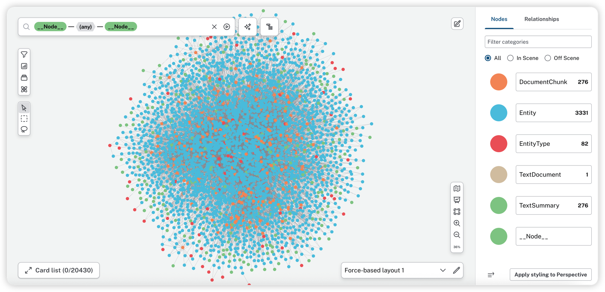
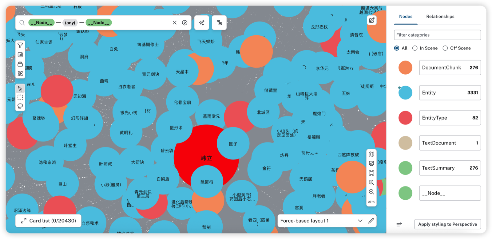
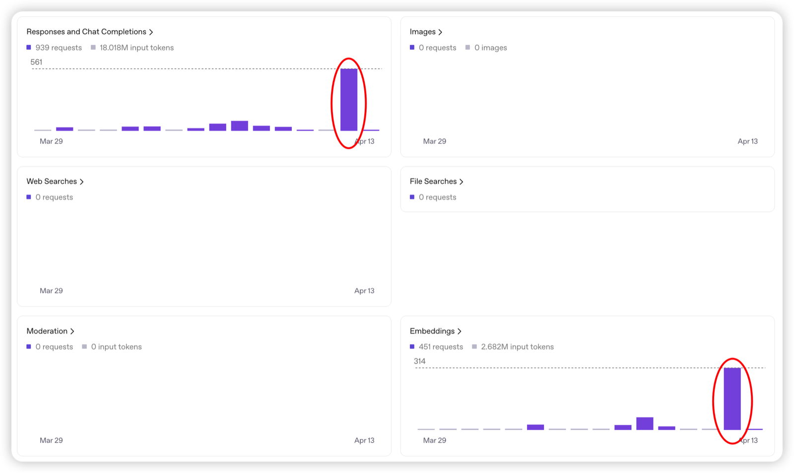

大模型只会「说」，却记不住，也无法推理人物关系与事件因果。本文梳理从 LLM 到 RAG 再到 Memory 系统的演进，并以 Cognee 为例，演示如何让大模型真正「读懂」《凡人修仙传》这样的超长篇网络小说。

## LLM 与「失忆症」

类似 GPT、DeepSeek 的大语言模型，在推理、生成和对话方面的能力突飞猛进，但它们有一个根本限制——没有长期记忆。LLM 的能力本质上依赖于两点：预训练知识（静态）、上下文窗口（短期）。

这导致两个核心问题：无法持续积累用户信息；难以处理跨文档、跨时间的复杂关系。围绕「让模型记住信息」的技术路径，经历了三阶段演进：LLM → RAG → Memory Systems。

早期的 LLM 完全依赖参数化知识（Parametric Knowledge）：知识写在模型权重中，推理能力强，但不可更新，且无法引用外部真实数据。它们都存在幻觉（Hallucination）、知识过时、无法个性化这类问题。

RAG（Retrieval-Augmented Generation）成为第一代「外部记忆」，典型架构：`Query → Embedding → Vector DB → Top-K Retrieval → LLM 生成`。还记得 RAG 刚被提出时，着实带火了一把向量数据库，如 Pinecone。RAG 有助于引入外部知识、降低幻觉，但向量的「相似性」不等同于人物事件的「相关性」，RAG 并不能提供人物事件的因果链条信息。

为了解决 RAG 的局限，Memory 系统开始出现：不只是「找内容」，而是「理解结构 + 记住关系」。Memory 系统的关键能力包括长期记忆（Long-term Memory）、结构化知识（Structured Knowledge）、可演化（Evolving Memory），比较知名的项目有 Mem0、Zep、Cognee 等。

## Hybrid Vector-Graph Memory

以上列举的几个 Memory 系统，普遍采用的方案是 Hybrid Vector + Graph Memory（向量 + 图混合记忆）。这其实也好理解，二者在能力上互补：向量数据库擅长语义匹配，但不擅长关系推理，图数据库则反之。大体上来说：Vector 一定程度上解决「找什么」，Graph 一定程度上解决「为什么」。

## 现在，让大模型读懂《凡人修仙传》

仅靠大模型本身来「读懂」像《凡人修仙传》这种超长篇小说，并准确回答人物关系、事件链条的问题，其实是有明显短板的。如果每次都上传整本小说，Token 消耗量巨大，同时还可能撞上上下文长度限制；再强的模型也有上下文窗口，另外没有持久性的记忆，很容易导致记忆与输出不稳定，并混淆细节。

这里以 Cognee 为例，展示主流记忆机制如何帮助大模型应用构建更准确、更稳定的持久记忆。

### Cognee 简介

项目地址：[topoteretes/cognee](https://github.com/topoteretes/cognee)

> Cognee is an open-source knowledge engine that lets you ingest data in any format or structure and continuously learns to provide the right context for AI agents. It combines vector search, graph databases and cognitive science approaches to make your documents both searchable by meaning and connected by relationships as they change and evolve.

### Cognee 安装

安装 Python 环境（Python 3.10 至 3.13），接着执行 `uv pip install cognee` 即可。Cognee 默认使用的向量数据库是 [lancedb](https://github.com/lancedb/lancedb)，默认使用的图数据库是 [kuzu](https://github.com/kuzudb/kuzu)。

### 图数据库的配置

这里为了图数据库显示得直观，我改成了 [Neo4j Aura](https://neo4j.com/product/auradb/)，即 Neo4j 的官方云数据库：可以创建一个免费实例，可存储 10 万点、30 万边，对普通项目来说足够了；另外它自带 Web 图形 UI。在 Neo4j Aura 中创建连接之后，点击实例右侧的「...」，再点击「Inspect」，就可以得到该实例的连接信息，将其配置到 Python 项目中：

```properties
GRAPH_DATABASE_PROVIDER="neo4j"
GRAPH_DATABASE_URL="neo4j+s://foobar.databases.neo4j.io"
GRAPH_DATABASE_NAME="foobar"
GRAPH_DATABASE_USERNAME="foobar"
GRAPH_DATABASE_PASSWORD="{password}"
GRAPH_DATABASE_ADAPTER="neo4j_aura_dev"
```

### LLM 的配置

最简的配置方法就是使用 OpenAI 的接口，仅需配置 `LLM_API_KEY` 即可：

```properties
LLM_API_KEY="sk-proj-......"
```

### 代码

```python
import os
from dotenv import load_dotenv

load_dotenv()

import asyncio
import cognee

async def fanren_cognify():
    from pathlib import Path

    current_directory = Path(__file__).resolve().parent
    file_path = os.path.join(current_directory, "data", "凡人修仙传(节选).txt")

    await cognee.add(file_path, dataset_name="fanren-universe")
    await cognee.cognify(datasets="fanren-universe")

    answer = await cognee.search("乱星海各大势力简述", datasets="fanren-universe")
    print(answer)


if __name__ == "__main__":
    asyncio.run(fanren_cognify())
```

这里主要就是 3 个方法：`cognee.add` 用于添加数据，可以是文件路径，也可以是字符串；`cognee.cognify` 用于提取知识，包括向量化以及图数据库点、边的提取；`cognee.search` 则是查询操作。

这里节选了全书四分之一左右的内容，实测耗时约 10 分钟以上，抽取实体约 3000+，边 6000+：





上述问题，Cognee 给出的回答如下，整体看质量还是不错的：

> 简述如下：星宫：乱星海的官方霸主，中心是天星城与神秘的「天星双圣」。通过内十二星岛（圣主任命）与外二十四星岛（天星城百年摘星大会）实际控制诸岛，表面不干涉城内事务但握有最高权威。诸侯与门派：夜龙岛、六连殿、极阴岛、魅魔宗、三仙门、四大商盟等为内星海的重要地方势力或宗门，既有自主地盘与人脉，也在利益上与星宫与彼此发生竞争或冲突。逆星盟：由正道与魔道等联合反对星宫的组织，公开挑战星宫霸权（并向天星城宣战），是目前直接对抗星宫的主要反对势力。势力关系特点：名义上星宫居中统治，实际为「强权＋封建式」控制；地方势力有时服从、有时联手抗衡；一旦星宫权威受疑（如「双圣」传言），各方便互相试探、结盟或阴谋扩张，局势易生动荡。总括：星宫是中心的统治轴心，地方宗派与商盟各据一方，逆星盟为显著反对力量，三者之间以制衡、结盟与暗斗为主，关系复杂且随局势快速变化。

## 成本

实测，对于节选的内容（约占全书的四分之一），大模型调用次数 500+，Embedding 模型调用次数 300+，费用约 $5。于是我又简单探索了一下本地模型的使用。



安装 Ollama 的过程就不赘述了。Embedding 模型用的是 bge-m3，LLM 试了几个：最开始试的是 Qwen2.5-7B（Q4_K_M 量化），发现总是答非所问，例如你问它「列举一下女性角色」，它的回答是：

```text
['I like to play basketball and watch movies in my free time.']
```

后来又小数据量试了一下 Qwen3-14B（Q4_K_M、Q5_K_M），以及 Qwen3-8B（Q5_K_M），效果还可以。对于问题「韩立在七玄门先还认识了哪些人」，答得还不错：

```text
['韩立在七玄门认识了三叔（引荐人，外门弟子）、王护法（护法）、岳堂主（堂主）、舞岩（同批测试者，后入七绝堂）、墨大夫（炼药导师）以及师兄张均和吴铭瑞。']
```

M4 Pro 芯片运行 Qwen3-14B 还是有些勉强，Qwen3-8B 好一些。有兴趣的同学也可以亲手构建一个完整的《凡人修仙传》知识图谱。

## 总结

从 LLM 到 RAG 再到 Memory，本质是一个问题的不断深化：如何让 AI 不仅「会说」，还「记得住、想得通」？类似 Cognee 这样的 Hybrid Memory 可以理解复杂长剧情，并进行多跳推理（Multi-hop Reasoning）。未来 Memory 系统将成为 AI 系统的基础设施并不断进化，类似自动抽象、自动删除冗余、记忆压缩等特性，将慢慢成为标配。
