## 1. 引言

前些天心血来潮，参加了一场 PL/SQL 工程师面试，期间被问到 Oracle 分析函数。PL/SQL 开发并非我的老本行，以前也很少用分析函数。一来要考虑数据库移植，二来很少遇到非用它不可的场景，三来语法相对复杂。这几天看了一些入门资料，才发现它们可以解决不少问题。手边暂时没有真实的应用场景，本文先用一张电影表演示。

## 2. 分析函数与聚合函数

先看一个常见的 SQL 错误 `ORA-00979: not a GROUP BY expression`。

```sql
SELECT title, corp, COUNT(*) cnt
FROM film
GROUP BY corp
ORDER BY corp;
```

这个查询按 `corp` 分组，却还试图直接返回每部影片的 `title`。删去 `title` 后，每个公司返回一条汇总记录。

```sql
SELECT corp, COUNT(*) af
FROM film
GROUP BY corp
ORDER BY corp;
```

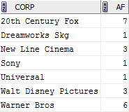

图中 20th Century Fox 共出品了 7 部电影。聚合后，这 7 部电影对应一条汇总记录。

有时我们既要公司级统计，也要保留每部影片的标题和年份。这时可以使用分析函数，给每一行附上它所在分区的统计结果。

```sql
SELECT title,year,corp,
COUNT(*) OVER (PARTITION BY corp) af
FROM film;
```

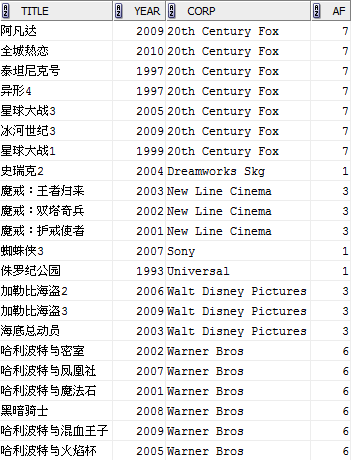

`PARTITION BY` 把行划分为不同的统计分区。查询结果的显示顺序由主查询的 `ORDER BY` 指定。

## 3. 基本语法

分析函数的结构可以概括为下面这样。

`function_name(arg1,arg2,...) OVER(<partition-clause> <order-by-clause > <window clause>)`

`OVER` 内的排序会在接下来的例子中说明，窗口子句放在最后一节。理解执行顺序时，可以分为三步。

1. 先处理 `JOIN`、`WHERE`、`GROUP BY` 和 `HAVING`。
2. 按分析子句划分分区，计算每行对应的分析结果。
3. 按主查询的 `ORDER BY` 对最终结果排序。

## 4. AVG、SUM、MAX、MIN、COUNT

这些常见的聚合函数也可以作为分析函数使用。下面先按公司计算平均票房。

```sql
SELECT title,corp,year,box_office,
ROUND(AVG(box_office) OVER (PARTITION BY corp)) af
FROM film;
```

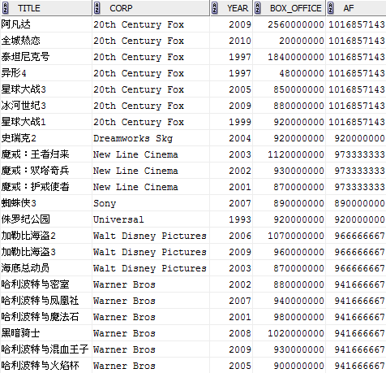

再看 `OVER` 内加入 `ORDER BY` 之后的效果。

```sql
SELECT title,year,corp,
COUNT(*) OVER (PARTITION BY corp ORDER BY year) af
FROM film;
```

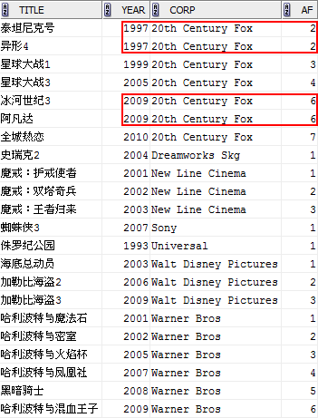

这里的计数是从分区开头到当前排序值的累计结果。在这个例子的默认窗口下，同一年份的行共享同一个累计值，例如图中的两个 1997 和两个 2009。

换成 `MAX`，就可以看到各公司按年份累计的最高票房。

```sql
SELECT title,corp,year,box_office,
MAX(box_office) OVER (PARTITION BY corp ORDER BY year) af
FROM film;
```

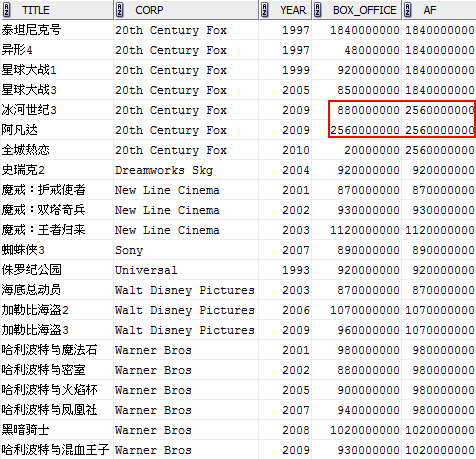

## 5. RANK、DENSE_RANK、ROW_NUMBER

```sql
SELECT title, corp, year,
RANK() OVER (PARTITION BY corp ORDER BY year) r,
DENSE_RANK() OVER (PARTITION BY corp ORDER BY year) dr,
ROW_NUMBER() OVER (PARTITION BY corp ORDER BY year) rn
FROM film;
```

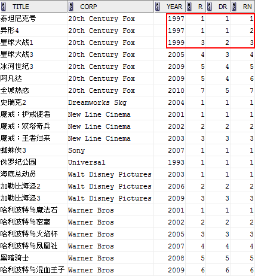

排序值重复时，这三个函数的区别最明显。以图中并列的两个 1997 年为例，`RANK` 和 `DENSE_RANK` 都会给并列行相同的名次。`RANK` 在并列后留出名次空档，`DENSE_RANK` 的两个 1 后面接着 2。`ROW_NUMBER` 则为每一行分配连续的序号。

用这些函数可以实现 Top N 查询。下面的例子选出各电影公司年份最早的影片，同一年份并列时也会一起返回。

```sql
SELECT * FROM (
  SELECT title,corp,year,
  RANK() OVER (PARTITION BY corp ORDER BY year) r
  FROM film
) t
WHERE t.r=1;
```

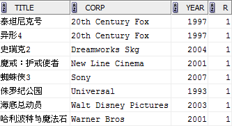

## 6. LEAD 与 LAG

`LEAD(<sql_expr>,<offset>, <default>) OVER (<analytic_clause>)`

`LAG(<sql_expr>,<offset>, <default>) OVER (<analytic_clause>)`

- `sql_expr` 通常是要取值的列。
- `offset` 是在分区的排序结果中偏移的行数，默认为 1。`LEAD` 取后面的行，`LAG` 取前面的行。
- `default` 是偏移超出分区范围时的返回值。

```sql
SELECT title,corp,year,box_office,
LEAD(box_office,1,-9999) OVER (PARTITION BY corp ORDER BY box_office) af1,
LAG(box_office,1,-9999) OVER (PARTITION BY corp ORDER BY box_office) af2
FROM film;
```

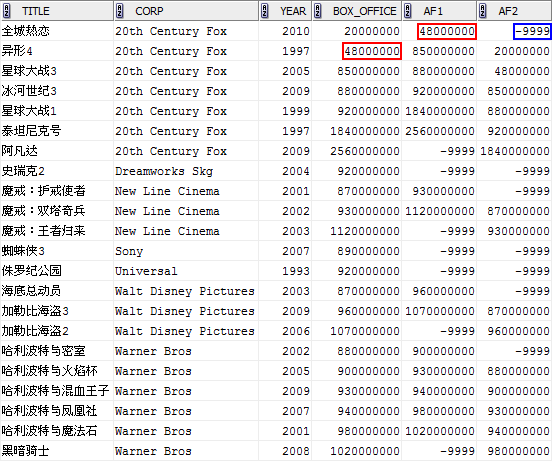

以结果中的 `AF1` 为例，偏移设为 1，因此第 N 行取得同一分区中第 N + 1 行的 `BOX_OFFICE`。超出分区范围时返回示例指定的 `-9999`。`AF2` 则用 `LAG` 取相反方向的值。

## 7. FIRST_VALUE 与 LAST_VALUE

`FIRST_VALUE` 返回当前窗口中第一行的值，`LAST_VALUE` 返回当前窗口中最后一行的值。窗口覆盖整个分区时，得到的就是分区排序后的首尾值。

```sql
SELECT title,corp,year,box_office,
box_office-(FIRST_VALUE(box_office) OVER (PARTITION BY corp ORDER BY box_office)) af
FROM film;
```

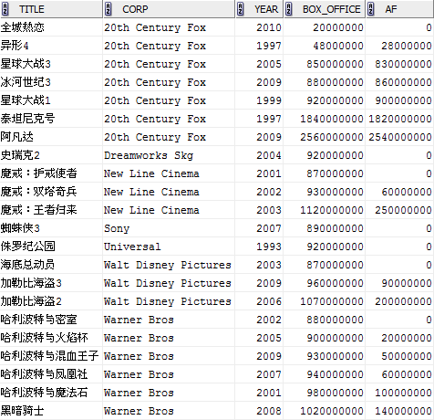

## 8. 窗口子句

前面的例子里，有些计算以整个分区为范围。窗口子句可以进一步限定每一行需要参与计算的范围。

```sql
SELECT title,corp,year,box_office,
MAX(box_office) OVER (PARTITION BY corp ORDER BY year ROWS BETWEEN 2 PRECEDING AND 1 FOLLOWING) af
FROM film;
```

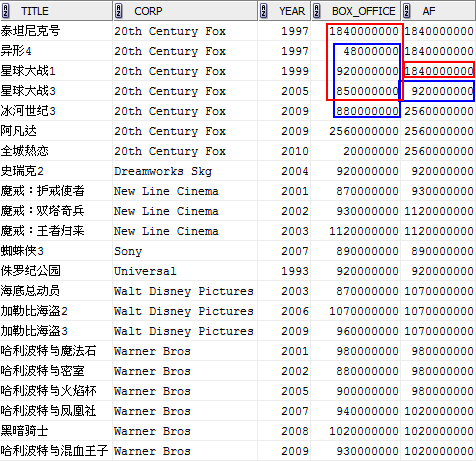

`ROWS BETWEEN 2 PRECEDING AND 1 FOLLOWING` 表示从当前行前两行到后一行。分区边界以外的行不计入窗口，因此窗口最多有四行。图中的红色 `1840000000` 是第 1 到第 4 行的最大值，蓝色 `920000000` 则是第 2 到第 5 行的最大值。

### ROWS 窗口

窗口的完整写法是 `ROWS BETWEEN <start_expr> AND <end_expr>`。起止边界可以使用下列写法。

- `N PRECEDING` 或 `N FOLLOWING`
- `UNBOUNDED PRECEDING` 或 `UNBOUNDED FOLLOWING`
- `CURRENT ROW`

也可以简写为 `ROWS N PRECEDING` 或 `ROWS UNBOUNDED PRECEDING`，此时窗口结束于当前行。

```sql
SELECT title,corp,year,box_office,
MAX(box_office) OVER (PARTITION BY corp ORDER BY year ROWS BETWEEN 2 PRECEDING AND CURRENT ROW) af1,
MAX(box_office) OVER (PARTITION BY corp ORDER BY year ROWS BETWEEN 2 PRECEDING AND UNBOUNDED FOLLOWING) af2,
MAX(box_office) OVER (PARTITION BY corp ORDER BY year ROWS BETWEEN 1 PRECEDING AND 2 PRECEDING) af3,
MAX(box_office) OVER (PARTITION BY corp ORDER BY year ROWS 2 PRECEDING) af4,
MAX(box_office) OVER (PARTITION BY corp ORDER BY year ROWS BETWEEN UNBOUNDED PRECEDING AND 1 FOLLOWING) af5,
MAX(box_office) OVER (PARTITION BY corp ORDER BY year ROWS BETWEEN 1 FOLLOWING AND 2 FOLLOWING) af6
FROM film;
```

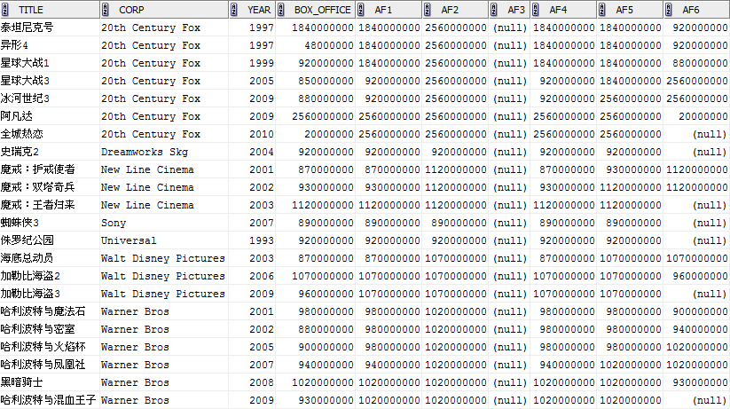

结果中的 `AF3` 为 `NULL`。`ROWS BETWEEN 1 PRECEDING AND 2 PRECEDING` 的起点在终点之后，窗口里没有数据行可供计算。

### RANGE 窗口

`ROWS` 按行的位置划定范围，`RANGE` 则按排序键的值划定范围。

```sql
SELECT title,corp,year,box_office,
MAX(box_office) OVER (PARTITION BY corp ORDER BY year RANGE BETWEEN 2 PRECEDING AND 1 FOLLOWING) af
FROM film;
```

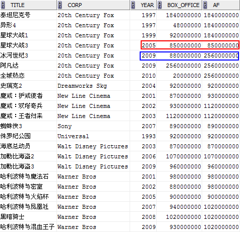

示例按 `year` 排序，因此窗口从当前年份往前两年，到往后一年。图中红色标记行的窗口为 `[2003, 2006]`，范围内只有该行，因此返回它自己的 `BOX_OFFICE`。蓝色标记行的窗口为 `[2007, 2010]`，返回该范围内的最大值 `2560000000`。

这些是比较常见的 Oracle 分析函数，可作为后续学习的起点。
