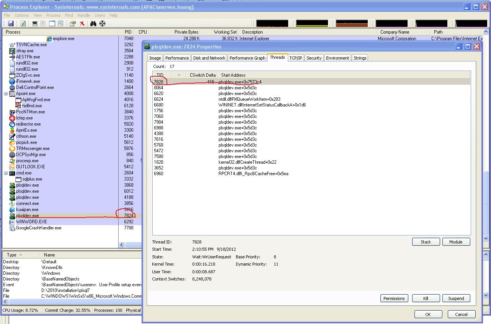
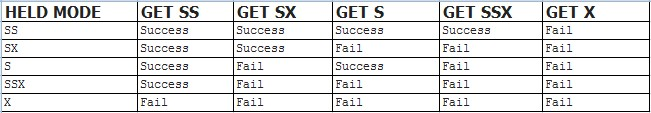

本文记录了 2012 年 Oracle 环境下的锁机制实验，命令提示符、会话编号与查询输出沿用原始记录。

## 锁机制的分类

今天我们来了解Oracle中一项重要的机制，锁机制，它在允许最大并发性能的前提下保证数据的一致与完整。很多文章在说到锁机制时，往往写得特别复杂，在各种锁之外，又引入了所谓的”意向锁”等等，同时在该详细的地方，比如锁的兼容性方面，缺乏进一步的解释。所以我倾向”简单粗暴”风格，尽量把内容往简单的写。我们先来看看Oracle锁机制的基本分类。

- DML locks

- DDL locks

- Internal locks and latches，内部锁及闩，保护内部数据库结构

- Distributed locks，分布式锁

- PCM locks，并行高速缓存管理锁

看起来很复杂的样子，不过我们今天的主要内容是DML locks，其他的暂时略过不表，DML locks又可以分成：

- TX锁，即事务锁（行级锁）

- TM锁，即表级锁

对于TX锁，其实只有一个模式，即排他模式（exclusive，下称X锁），并不特别复杂，TM锁相对复杂一点。

## 锁机制的基本示例

```text
SESS#132 SQL> insert into t_lock_1 values(1, 'a');
1 row inserted

SESS#132 SQL> select sid,type,id1,lmode, request from v$lock l where l.SID in (132, 202) and l.TYPE in ('TM','TX');
       SID TYPE        ID1      LMODE    REQUEST
---------- ---- ---------- ---------- ----------
       132 TM       109413          3          0

       132 TX       131075          6          0
```

v$lock的lmode相应数值的含义是：

- 0—none,

- 1—null,

- 2—row share (RS), 或sub share(SS)，下称SS

- 3—row exclusive (RX), 或sub exclusive(SX)，下称SX

- 4—share (S),

- 5—share row exclusive (SRX), 或share sub exclusive (SSX)，下称SSX

- 6—exclusive (X).

Oracle在DML时自动获得的表级锁只有SX一种模式，其它的模式需要通过手工的Lock table才能获得；自动获得的事务锁也只有一种模式：X。

另外可以看到，当我们插入一条数据（未提交）时，获得了两个锁，一个表级的SX，表明此表下的某些行正在被更改；另一个事务级的X，表明此数据行正在被我独占。

```text
SESS#132 SQL> insert into t_lock_1 values(2, 'b');
1 row inserted
SESS#132 SQL> select sid,type,id1,lmode,request from v$lock l where l.SID in (132, 202) and l.TYPE in ('TM','TX');
       SID TYPE        ID1      LMODE    REQUEST
---------- ---- ---------- ---------- ----------
       132 TM       109413          3          0
       132 TX       196633          6          0
```

我们插入了第二行记录，表级锁数量未增加，因为是操作的是同一表； 事务锁数量也未增加，因为它们是在同一事务中。

```text
SESS#202 SQL> insert into t_lock_1 values(3, 'c');
1 row inserted
SESS#202 SQL> select sid,type,id1,lmode, request from v$lock l where l.SID in (132, 202) and l.TYPE in ('TM','TX');
       SID TYPE        ID1      LMODE    REQUEST
---------- ---- ---------- ---------- ----------
       202 TM       109413          3          0
       132 TM       109413          3          0
       202 TX       655370          6          0
       132 TX       196633          6          0
```

在SESS#202中插入了第三条记录，这次我们看到了四条锁记录。同时，我们也看到了，表级的SX锁是相容的，这个下文会有解释。

```text
SESS#132 3:12:18 PM SQL> commit;
Commit complete
SESS#132 3:12:22 PM SQL> update t_lock_1 set val='aa' where id=1;
1 row updated

SESS#202 2:45:08 PM SQL> commit;
Commit complete
SESS#202 3:13:25 PM SQL> update t_lock_1 set val='aa' where id=1;
```

更新同一条记录，此时SESS#202被阻塞

```text
SESS#132 3:15:05 PM SQL> select sid, type, id1,lmode, request from v$lock l where l.SID in (132, 202) and l.TYPE in ('TM','TX');
       SID TYPE        ID1      LMODE    REQUEST
---------- ---- ---------- ---------- ----------
       202 TX       524318          0          6
       132 TM       109413          3          0
       202 TM       109413          3          0
       132 TX       524318          6          0
```

可以看见SESS#202成功获得了表级的SX，但在获得事务级锁时出现问题。这里我们看request列，request列即表示session希望获得的锁的类型，第一行中的6表示SESS#202希望获得事务级的X锁，而lmode字段的0则表示实际上未获得。

```text
SESS#132 3:18:59 PM SQL> select event, seconds_in_wait, sid from v$session_wait where sid in (132,202);
EVENT                            SECONDS_IN_WAIT        SID
-------------------------------- --------------- ----------
SQL*Net message from client                    0        132
enq: TX - row lock contention                325        202
```

可以看到SESS#202的等待事件，enq即enqueue，表示排队等待，TX – row lock contention表明在事务锁上存在争用。

```text
SESS#132 3:24:12 PM SQL> select s1.username || '@' || s1.machine || ' ( SID=' || s1.sid ||
       ' )  is blocking ' 
       || s2.username || '@' || s2.machine || ' ( SID=' || s2.sid || ' ) ' AS blocking_status
  from v$lock l1, v$session s1, v$lock l2, v$session s2
 where s1.sid = l1.sid
   and s2.sid = l2.sid
   and l1.BLOCK = 1
   and l2.request > 0
   and l1.id1 = l2.id1
   and l2.id2 = l2.id2;

BLOCKING_STATUS
--------------------------------------------------------------------------------
SYSTEM@APAC\L00056378 ( SID=132 )  is blocking SYSTEM@APAC\L00056378 ( SID=202 )
```

用上面的查询可以清楚地看到谁在阻塞谁

```text
SESS#132 3:25:35 PM SQL> commit;
Commit complete

SESS#202 3:25:40 PM SQL> commit;
Commit complete
```

上面列举的修改同一行数据造成的阻塞是我们最常见到的，还有一些情况也会导致阻塞，比如：SESS#1向表的主键列插入一值但未提交，SESS#2向此主键列插入相同值，则SESS#2被阻塞。有外键约束的表也存在类似的情况，即SESS#1向父表插入一值但未提交，SESS#2尝试引用此值，则SESS#2被阻塞。

## Select for update语句与锁

```text
SQL> select * from t_lock_1 for update;
SQL> select sid,type,id1,lmode,request from v$lock l where l.SID =74 and l.TYPE in ('TM','TX');
       SID TYPE        ID1      LMODE    REQUEST
---------- ---- ---------- ---------- ----------
        74 TM       109413          3          0
        74 TX       458763          6          0
```

很多文章中涉及select for update都表示这个语句会获得事务级的X锁，及表级的SS锁，后者其实是不正确的，从9.2.0.5以后，其在表级别上获得的就是SX锁，参见上面的查询。也就是说，它跟DML语句获得的锁是一样的。

## Lock table命令与锁

到目前为止，我还很少在实际的应用开发中使用过Lock table，事实上，Oracle也不推荐对表的手工Lock，不过为了文章内容的完整，这里也简单做一些介绍。其中lock mode主要包括lmode中列出的几种。

前面我们说到Oracle自动获取的表级锁的只有SX一种，但是使用Lock table语句则可以将表置于其它任意一种锁模式中。

关于Lock table语句中的[nowait | wait n]选项，可以参见下面的示例，我们在SESS#1中将表lock，SESS#2尝试锁定同一表，在nowait的情况下，lock table语句立即出错，而在wait 10的情况下，语句等待了10秒钟，之后才报错。

```text
SESS#1 4:55:54 PM SQL> lock table t_lock_1 in row exclusive mode;
Table(s) locked

SESS#2 4:56:04 PM SQL> lock table t_lock_1 in exclusive mode nowait;
lock table t_lock_1 in exclusive mode nowait
ORA-00054: resource busy and acquire with NOWAIT specified or timeout expired
SESS#2 4:56:05 PM SQL>

SESS#2 4:58:10 PM SQL> lock table t_lock_1 in exclusive mode wait 10;
lock table t_lock_1 in exclusive mode wait 10
ORA-00054: resource busy and acquire with NOWAIT specified or timeout expired
SESS#2 4:58:21 PM SQL>
```

## 谁占用了锁？

通常，如果在发生锁的时候能得知是哪个用户造成的，无疑更有利于问题的解决。这时，需要借助v$session视图。

```text
SQL> select vl.SID,vl.ID1,vl.LMODE,vs.USERNAME, vs.OSUSER,vs.MACHINE,vs.PROGRAM,vs.PROCESS from v$lock vl join v$session vs on vl.SID=vs.SID and vl.type='TM';
       SID        ID1      LMODE USERNAME   OSUSER               MACHINE              PROGRAM              PROCESS
---------- ---------- ---------- ---------- -------------------- -------------------- -------------------- ------------------------
        15     109425          3 SYSTEM     APAC\Morven.Huang    APAC\L00056378       plsqldev.exe         7824:7828
```

有了v$session视图中数据的帮助，我们就能确定具体是谁阻塞了大家。甚至于，借助v$session视图中的process字段，我们还能更详细地知道是哪个进/线程，以上述查询结果为例，如果你打开了多个plsqldev，可以借助process字段确定引发阻塞的语句是在哪个plsqldev进/线程中执行的。



当然，我们也可以关联v$process视图（v$session.paddr =  v$process.addr）查看更加详细的进程信息（虽然它们并没有太大的用处）。

另外，我们也可以具体查看是哪些对象被锁了，对于表级锁，v$lock中的字段ID1即object_id，我们可以关联系统字典dba_objects来得到对象信息。

```text
SQL> select vl.sid, vl.type, vl.id1,vl.lmode, do.object_name,do.object_type from v$lock vl join dba_objects do on vl.ID1=do.object_id and type='TM';
       SID TYPE        ID1      LMODE OBJECT_NAME     OBJECT_TYPE
---------- ---- ---------- ---------- --------------- -------------------
        15 TM       109425          3 T_LOCK_3        TABLE
```

## 表级锁兼容性的解释



解释一下，首先，我们说，就严格程度而言，X锁高于S锁，而对象锁又高于子对象锁，这两点应该没什么异议。

前面说过，SS与SX中第一个字母是指的Sub，即子对象（我们可以把行理解成表的子对象），因此SS与SX级别最低，S次之，而SSX可以理解成S+SX，比S锁高，X则毫无疑问是最高的。这就是表格第一列从上到下的顺序了。

再来看兼容性问题，SS，SX互相兼容，因为，无论SS，SX，实际上表示的是表中的一部分数据行被锁，如果其他用户请求表中另外的数据行，Oracle没有理由拒绝，从保证并发性能来讲，它们也必须兼容。有人要问：如果两个人申请锁定的是表相同的数据行怎么办？没关系，这里我们讨论的是表级锁，我们还有事务锁，由它来控制。

SX与S不相容，S即Share，只有存在多人，才有所谓的共享，那么，多人同时查看一张表，如果其中一个人修数据或者表结构，他一定会被其他人鄙视的，所以这种情况下，SX与S不能兼容。那么，如果只有一个SESSION持有S锁，这个SESSION可以修改数据吗？答案是可以，因为只有一个SESSION持有锁的情况下，实际上也就无所谓”共享”了。

```text
SESS#136 12:55:05 PM SQL> select sid from v$session where audsid=userenv('SESSIONID');
       SID
----------
       136

SESS#75 12:55:11 PM SQL> select sid from v$session where audsid=userenv('SESSIONID');
       SID
----------
        75

SESS#136 12:55:46 PM SQL> lock table t_lock_4 in share mode;
Table(s) locked
 
SESS#75 12:56:13 PM SQL> update t_lock_4 set val='aa' where id=1;
```

SESS#75中的update语句被阻塞。Ctrl+C中止SESS#75中的DML。

```text
SESS#136 12:57:56 PM SQL> select * from v$lock where sid=136 and type in ('TM','TX');
ADDR     KADDR           SID TYPE        ID1        ID2      LMODE    REQUEST      CTIME      BLOCK
-------- -------- ---------- ---- ---------- ---------- ---------- ---------- ---------- ----------
0F346634 0F346664        136 TM       109427          0          4          0        143          0
2A49D1E8 2A49D228        136 TX       262149      12143          6          0        143          0

SESS#136 12:58:11 PM SQL> update t_lock_4 set val='aa' where id=1;
1 row updated

12:59:28 PM SQL> select * from v$lock where sid=136 and type in ('TM','TX');
ADDR     KADDR           SID TYPE        ID1        ID2      LMODE    REQUEST      CTIME      BLOCK
-------- -------- ---------- ---- ---------- ---------- ---------- ---------- ---------- ----------
0F346634 0F346664        136 TM       109427          0          5          0          2          0
2A49D1E8 2A49D228        136 TX       262149      12143      6          0        223          0
```

此时，表级锁已经升级成5，即SSX

## DBMS_LOCK的使用

DBMS_LOCK是Oracle提供给用户用于自定义锁的一个包，下面做一个示例，利用锁机制模拟让两条语句同时执行。当然，DBMS_LOCK的本职用途是在开发时控制多个进线程间的同步，这跟C#中的锁机制是一样的。

SESS#1

```sql
declare
  v_lockhandle varchar2(200);
  v_result     number;
begin
  dbms_lock.allocate_unique('control_lock', v_lockhandle);
  v_result := dbms_lock.request(v_lockhandle, dbms_lock.x_mode);
end;
```

SESS#2

```sql
declare
  v_result     number;
  v_lockhandle varchar2(200);
begin
  dbms_lock.allocate_unique('control_lock', v_lockhandle);
  v_result := dbms_lock.request(v_lockhandle, dbms_lock.ss_mode);
  insert into t_lock_5 values (2, systimestamp);
  commit;
end;
```

SESS#3

```sql
declare
  v_result     number;
  v_lockhandle varchar2(200);
begin
  dbms_lock.allocate_unique('control_lock', v_lockhandle);
  v_result := dbms_lock.request(v_lockhandle, dbms_lock.ss_mode);
  insert into t_lock_5 values (3, systimestamp);
  commit;
end;
```

此时SESS#2, SESS#3都被阻塞。

SESS#1 （释放锁）

```sql
declare
  v_lockhandle varchar2(200);
  v_result     number;
begin
  dbms_lock.allocate_unique('control_lock', v_lockhandle);
  v_result := dbms_lock.release(v_lockhandle);
end;
```

查看表t_lock_5中的结果

```text
SQL> select * from t_lock_5;
       SID TS
---------- -------------------------------------------------
         2 20-SEP-12 04.16.59.133000 PM
         3 20-SEP-12 04.16.59.133000 PM
```

示例很简单，DBMS_LOCK提供了申请锁（request）与释放锁（release）的方法，另外， allocate_unique提供辅助功能，用户可以用它将锁的名称（上面的“control_lock”）转换成lock handle，以便申请或释放的时候使用。另外，DBMS_LOCK包中还有一个sleep过程，与C#中Thread.sleep类似，也是将进线程置于休眠状态，可以通过参数指定具体的休眠时间（单位为秒）。
