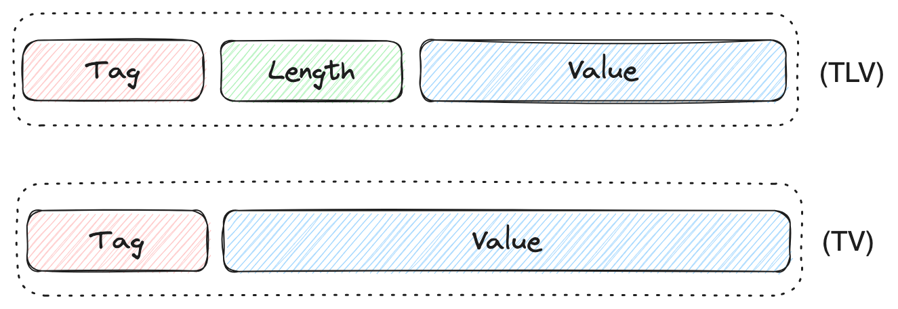
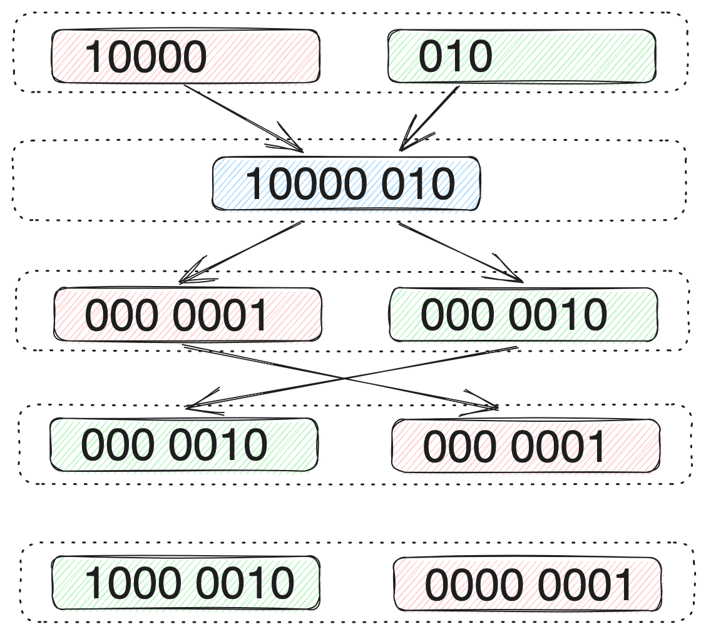

京东广告系统中，Google Protocol Buffers（下称 Protobuf）是被广泛使用的序列化库，相信很多人在开发过程中都使用过。今天我们深入一点，来了解一下 Protobuf 数据的内部布局。

# 消息定义

以广告曝光日志为例，简单介绍一下 Protobuf 消息 Schema 的定义。首先是 Stream 消息，其中 `data_list` 字段是具体的一条或多条日志数据：

```protobuf
message Stream {
  optional bool is_compressed = 1;
  repeated bytes data_list = 2;
}
```

`data_list` 中的数据，对应的消息定义是 ArchiveLogInfo：

```protobuf
message ArchiveLogInfo {
  optional CommonLogInfo commonLogInfo = 1;
  optional AdSearchLogInfo searchLogInfo = 2;
  repeated AdImpressLogInfo impressLogInfo = 3;

  message AdImpressLogInfo {
    optional string sid = 1;
    optional int32 pos_id = 2;
    optional int64 material_id = 3;
    ……
  }
……
}
```

消息的定义是比较直观的，每一个消息会有若干个字段，每个字段可以是数值、字符串等，也可以是另一个嵌套消息。同时，每一个字段还包含一个整型的编号，即字段的 Index。

# Protobuf Wire Type

Protobuf 中的数据类型分为以下 6 类：

| ID | Name | Used For |
| --- | --- | --- |
| 0 | VARINT | int32, int64, uint32, uint64, sint32, sint64, bool, enum |
| 1 | I64 | fixed64, sfixed64, double |
| 2 | LEN | string, bytes, embedded messages, packed repeated fields |
| 3 | SGROUP | group start (deprecated) |
| 4 | EGROUP | group end (deprecated) |
| 5 | I32 | fixed32, sfixed32, float |

# 数据布局

简单来说，Protobuf 数据的组织方式有两种：

- Tag-Length-Value（TLV）
- Tag-Value（TV）

其中：

- Tag：表示字段的类型与字段的 Index。
- Value：表示字段值。
- Length：表示字段值的长度。对于 LEN 类型，会额外存储此信息，以便在不需要该字段时可以快速跳过。



# VARINT 类型

变长整型 VARINT 在 Protobuf 数据布局中起到至关重要的作用，包括上面提到的 Tag 和 Length 信息，都是使用 VARINT 类型进行存储的。

大多编程语言习惯使用定长的字节来表示整型，例如 Java 使用 4 个字节，而变长整型 VARINT 使用 1~10 个字节来存储一个 64 位无符号整型，数值越小，所使用的字节数也越少。由于日常使用的数值通常都较小，因此使用 VARINT 有利于减少存储和节约网络传输的成本。

VARINT 每一个字节的第一位，被称为 Most Significant Bit（MSB），剩下的 7 位才是用来存储数据的。MSB 用于标识后一个字节是否属于同一个 VARINT，这意味着当遇到 `MSB = 0`，则表示该 VARINT 读取结束。

对于较小的整型，例如 9，可以直接使用一个字节：`0000 1001`。

数值大一点，例如 1500，编码则会复杂一点：

```text
2^10 + 2^8 + 2^7 + 2^6 + 2^4 + 2^3 + 2^2 = 1500
1500 的二进制：0000 0000 0000 0000 0000 0101 1101 1100
```

可以看到，它实际使用了 11 位的二进制。由于 VARINT 中每个字节实际可用的只有 7 位（扣除 MSB），因此需要两个字节来表示 1500。通过补 0，我们把这 11 位分割成两个 7 位：

```text
000 1011    101 1100
```

为了运算方便，Protobuf 在做 VARINT 的编码时，还做了字节位置的交换：

```text
101 1100    000 1011
```

将 MSB 补上：

```text
1101 1100    0000 1011
```

`1101 1100` 是一个负数，减 1 取反后，可以得到值为 -36；`0000 1011` 比较简单，是 11。因此，数值 1500 被编码为 2 个字节，值分别为 -36、11。

数值再大一点，例如 1308，编码则会复杂一点：

```text
2^10 + 2^8 + 2^4 + 2^3 + 2^2 = 1308
1308 的二进制：0000 0000 0000 0000 0000 0101 0001 1100
```

可以看到，它实际使用了 11 位的二进制。同样因为每个字节实际可用 7 位，需要两个字节来表示 1308。通过补 0，把这 11 位分割成两个 7 位：

```text
000 1010    001 1100
```

交换字节位置：

```text
001 1100    000 1010
```

将 MSB 补上：

```text
1001 1100    0000 1010
```

`1001 1100` 是一个负数，减 1 取反后，可以得到值为 -100；`0000 1010` 比较简单，是 10。因此，数值 1308 被编码为 2 个字节，值分别为 -100、10。

# Tag

在 TLV/TV 组织方式中，Tag 包含一个或多个字节，用以表示字段的类型与字段的 Index。

Tag 自身是一个 VARINT，因此包含一个或多个字节。其二进制的最后 3 位，用于表示数据类型（Wire Type）的 ID；剩下的位数，则用来表示字段 Index。

VARINT 的每一个字节，实际用于存储数据的只有 7 位，再扣除后 3 位用于表示数据类型，则只有 4 位用于表示字段 Index，因此，当一个消息拥有超过 15 个字段时，就必须使用 2 个或以上的字节来存储 Tag 了。

例如我们有一个 string 类型的字段，即类型 ID 为 2，字段的 Index 为 16，那么 Tag 就是这样的：

首先，16 的二进制为 10000，2 的二进制为 010，拼接后是 10000010，按 7 位进行拆分：

```text
000 0001    000 0010
```

交换之后：

```text
000 0010    000 0001
```

将 MSB 补上：

```text
1000 0010    0000 0001
```

即 Tag 使用 2 个字节，值分别为 -126、1。



# 代码

以文章最开始的广告曝光日志为例，我们准备一条测试日志，并序列化成字节数组。随后，我们根据 Protobuf 的数据布局，在不进行反序列化的情况下，获取广告曝光日志的广告位（pos_id）：

```java
public static void main(String[] args) {
    byte[] bs = prepareBytes();
    // for simplicity, set current position to 4 to skip 'data_list' Tag byte, 'data_list' Len byte,
    // 'impressLogInfo' Tag byte, and 'impressLogInfo' Len byte
    int pos = 4;
    int index = (bs[pos] & 0x7F) >> 3; // get 'AdImpressLogInfo.sid' field index
    if (index == 1) { // check if field 'AdImpressLogInfo.sid' exists
        pos = skipVarint(bs, pos); // skip 'AdImpressLogInfo.sid' Tag byte(s)
        ValueAndPosition vap = readVarint(bs, pos); // get Len of 'AdImpressLogInfo.sid'
        pos = vap.pos + vap.val; // skip 'AdImpressLogInfo.sid' Value
    }

    pos = skipVarint(bs, pos); // skip 'AdImpressLogInfo.pos_id' Tag byte(s)
    ValueAndPosition ret = readVarint(bs, pos); // read 'AdImpressLogInfo.pos_id' Value
    System.out.println(ret.val); // output: 1308
}

// return varint payload along with current position in the byte array
private static ValueAndPosition readVarint(byte[] bs, int pos) {
    int result = 0;
    int shift = 0;
    int b;
    do {
        if (shift >= 32) {
            throw new IndexOutOfBoundsException("Oops, too large to be a Java Integer");
        }
        b = bs[pos++];
        result |= (b & 0x7F) << shift;
        shift += 7;
    } while ((b & 0x80) != 0 && pos < bs.length);
    ValueAndPosition vap = new ValueAndPosition(result, pos);
    return vap;
}

// skip varint by checking MSB
private static int skipVarint(byte[] bs, int pos) {
    int index = pos;
    while (index < bs.length) {
        if (bs[index] >> 7 == 0) {
            break;
        }
        index++;
    }
    return index + 1;
}

@Data
@AllArgsConstructor
public static class ValueAndPosition {
    private Integer val;
    private Integer pos;
}

private static byte[] prepareBytes() {
    AdImpressLogInfo.Builder cb = AdImpressLogInfo.newBuilder();
    cb.setSid("foobar");
    cb.setPosId(1308);

    ArchiveLogInfo.Builder ali = ArchiveLogInfo.newBuilder();
    ali.addImpressLogInfo(cb);

    Stream.Builder s = Stream.newBuilder();
    s.addDataList(ali.build().toByteString());

    return s.build().toByteArray();
}
```

# 最后

通过上述介绍，我们可以窥见 Google Protocol Buffers 内部的数据布局。这种紧凑的结构使得 Protobuf 数据在网络传输和存储时更加高效。类似的解决方案也存在于其他知名项目中，如 Apache Avro、Lucene 和 Kafka 等等。

此外，了解数据布局，可以帮助开发人员优化消息 Schema 来进一步节约存储成本。例如对拥有大量字段的消息进行改造，使用嵌套消息来减少字段，从而在一定程度上减少 Tag 所占用的存储空间。
