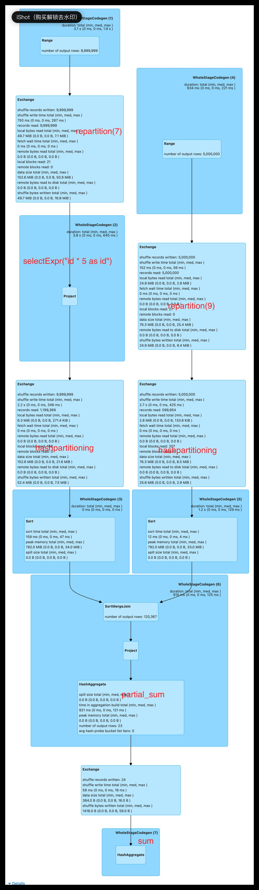

# 前言

Stage（阶段）是 Spark 执行引擎中任务调度和并行计算最核心的逻辑单元，它直接影响着任务的划分、资源调度以及最终的执行效率。理解 Stage 的形成逻辑（如宽窄依赖的划分）、作用原理以及调优方法，有助于洞悉作业执行的脉络，发现瓶颈，提升数据处理能力。

# Action，Transformation

Spark 算子分为 Action 和 Transformation，区别是：Transformation 总是返回数据集，而 Action 总是拉取数据到 Driver 或者将数据写入到存储系统。Action 会触发任务的执行。注：部分 Transformation 也会导致数据写出，例如宽变形 `groupByKey`、`reduceByKey`，但需要注意的是，这里的数据是写入到本地。

常见的 Transformation：`map`、`flatMap`、`filter`、`mapPartitions`、`sample`、`union`、`intersection`、`groupByKey`、`reduceByKey` 等。

常见的 Action：`count`、`collect`、`first`、`take`、`show`（内部是 take）、`saveAsTextFile` 等。

注意，这里的这些方法都是指 RDD 方法，与 Spark SQL 并不能完全一一对应。

---

# Wide/Narrow Transformation

有时候也称为宽依赖、窄依赖，不过更清晰的提法是宽变形、窄变形，它表明这两个概念只和 Transformation 有关，与 Action 无关。

1. 窄变形，是指上游的一个分区，只会进入到下游的一个分区，想象一下 `where` 操作或者 `map` 操作。
2. 宽变形，是指上游的一个分区中的数据，会分发至下游的多个分区，想象一下 `group by` 操作。

宽变形导致 shuffle，即大量的数据在不同的节点之间传输，这是比较昂贵的操作；窄变形则不会导致 shuffle。

主要的窄变形：`map`、`mapPartitions`、`mapPartitionsWithIndex`、`filter`、`flatMap`、`union`、`coalesce`。这里除了 `coalesce`，剩下的窄变形中，父 RDD 的分片与子 RDD 的分片是完全的一对一的关系。换而言之：对于窄依赖，数据流动的单位是分区，子 RDD 的一个分区，依赖的是父 RDD 的一个或若干个分区的**整个分区数据**，不存在父 RDD 的分区中的一部分流入下游的一个分区、另一部分流入下游的另外一个分区。

需要注意的是：除了 `repartition`、`coalesce` 这两个显式修改分区数的操作外，不论宽变形、窄变形，默认都不改变 RDD 分区。这里说的是默认，有些方法如 `reduceByKey` 有一个重载是可以指定分区数量的。另外，`union` 操作实际也不改变分区数，例如两个 RDD 做 `union`，一个有 2 个分区，一个有 3 个分区，最后的结果是 5 个分区。

---

# 宽变形与 Stage

Spark 根据宽变形对任务划分 stage，也可以说是按 shuffle 划分 stage。在流程上，从后往前推，遇到 shuffle 就切分。其中 shuffle read 属于后一个 stage，而 shuffle write 属于前一个 stage。每个 stage 里 task 的数量（即并行度）由 stage 最后一个 RDD 中的分区数决定。如果 stage 要生成 result，则该 stage 里的 task 都是 ResultTask，否则是 ShuffleMapTask。

## 补充 1：shuffle

shuffle 是一个逻辑概念，真正在物理动作上，是分为两部分：shuffle write、shuffle read。shuffle write 将分区数据信息写入**本地磁盘**，并将包括数据位置、键信息写入 `BlockManager` 服务中。shuffle read 则依赖 `BlockManager` 中的元数据去拉取信息，采用的是 pull 模式。

在 stage 划分时，其中的 shuffle write 归属上一个 stage，而 shuffle read 归属下一个 stage。这一点从 Spark Web UI 中可以看出来，例如对于一个 `groupByKey`，会导致划分 stage，并且前一个 stage 只有 shuffle write，后一个 stage 只有 shuffle read。

## 补充 2：stage 划分的本质

一个 stage 内是多个并行的线程（task），分别处理不同的数据分区。shuffle 为什么必然导致 stage 的划分？因为当一个 stage 中的某个线程处理完一个分区数据并写入本地磁盘之后，这个线程就进行不下去了，因为接下来的 shuffle read 动作（数据拉取）显然必须由其他节点上的线程来完成，而且可能是多个节点上的线程都来这里拉取数据。

**所以，stage 划分的本质就是：由于 shuffle 动作的「两阶段」特性，数据处理链路无法放到一个线程内完成。**

---

# repartition vs. coalesce

`repartition` 方法是一个宽变形，`coalesce` 方法是一个窄变形。由于宽变形会导致 shuffle，而 shuffle 一般是我们需要避免的，因此，当要减少分区时，一般都推荐使用 `coalesce` 方法。

但这不是绝对的。例如当我们的任务中有如下步骤进行数据的处理和存储：

```text
read data --> build dataframe --> coalesce OR repartition? --> save to hdfs
```

这里我们想在输出前限制写出文件的数量为 10。如果使用 `coalesce(10)`，由于 `coalesce` 是窄变形，会导致 `save` 操作和生成 DataFrame 的操作处于同一个 stage，并且都用该 stage 后端的并发度 10，这种情况下如果 HDFS 的数据量很大，任务耗时将大大增加。这种场景下，使用 `repartition` 反而耗时更少。

---

# 查看执行计划

在 IDE、或者 Spark 命令行使用 `explain` 方法打印的执行计划，与通过 `Spark Web UI → SQL → Details` 查看到的执行计划有时候并不一致，原因未明。下文讨论以 Spark UI 的执行计划为准。

当在 IDE 执行 Spark 任务时，可以看到形如 `INFO SparkUI: Bound SparkUI to 0.0.0.0, and started at http://x.x.x.x:4040` 的日志，这就是 Spark Web UI 地址。

当在 IDE 执行 Spark 任务时，为防止测试任务过快结束导致无法查看 Spark Web UI，可以在程序中添加 `Thread.sleep()` 进行延迟；使用断点阻塞的方式不行，Web UI 无法打开。

还有一点需要注意，使用像 `take`、`show` 这类操作，可能会导致出现多个 job，而不是一个 job 下的多个 stage。

在阅读执行计划的时候，要从下往上读。

Exchange，即 Shuffle，因此当出现 Exchange 时，就会触发新的 stage。

两个连续的 Exchange，不会触发两个新的 stage，而是一个。

在 Spark UI 上查看 SQL 执行时，会经常看到「全阶段代码生成（Whole-stage Code Generation）」，这表示将 SQL 转换成 Java 代码的过程。

一个 stage 包含多个 task，在一个 stage 中，`number-of-tasks = number-of-partitions`。但是所有这些 task 能否在同一时刻完全并行执行，还受限于硬件资源。

---

# 例一

```java
SparkSession spark = SparkSession.builder()
        .master("local[3]")
        .appName("SparkByExample")
        .getOrCreate();

List<Row> rows = new ArrayList<>();
for (int i = 0; i < 1000000; i++) {
    Row row1 = RowFactory.create(i, "Bill Chambers " + i);
    rows.add(row1);
}

StructField f1 = DataTypes.createStructField("id", DataTypes.IntegerType, true);
StructField f2 = DataTypes.createStructField("name", DataTypes.StringType, true);
StructType schema = DataTypes.createStructType(Arrays.asList(f1, f2));

Dataset<Row> df = spark.createDataFrame(rows, schema).repartition(3);
df.createOrReplaceTempView("foo");
spark.sql("select * from foo limit 3").show();
```

```text
== Physical Plan ==
* Project (6)
+- * GlobalLimit (5)
   +- Exchange (4)
      +- * LocalLimit (3)
         +- Exchange (2)
            +- LocalTableScan (1)
// 注：由于这里的两个 Exchange，整个任务被划分成了 3 个 stage。

// 本地表扫描。这里实际是我手动构造了一个 DataFrame，并使用它注册了一个表 foo。
(1) LocalTableScan
Output [2]: [id#0, name#1]
Arguments: [id#0, name#1]

// 从下往上第一个 Exchange，它的 Arguments 是 RoundRobinPartitioning(3)，这是因为我们调用了 repartition(3) 方法，所以这里出现了「轮询分区」。
// 所谓的轮询分区就是：第一条数据分配到第一个分区，第二条数据分配到第二个分区，以此类推，直到所有的数据项都被分配到分区为止。
// 当对数据集进行 repartition 操作时，Spark 默认使用最简单的轮询分区。
(2) Exchange
Input [2]: [id#0, name#1]
Arguments: RoundRobinPartitioning(3), REPARTITION_WITH_NUM, [id=#18]

// 在各个分区上执行 limit。Spark 由于是分布式处理，当遇到 limit n 子句时，采用的策略是在各分区上执行 limit n，这样可以大幅降低所需要处理的数据量，然后再汇总进行最后的 limit。
(3) LocalLimit [codegen id : 1]
Input [2]: [id#0, name#1]
Arguments: 3

// Exchange SinglePartition，实际上就是将上述的各分区上执行 limit 之后的结果汇总到一起。除了 limit，包括很多常见的聚合操作 count()、sum() 等，都需要 Exchange SinglePartition。
(4) Exchange
Input [2]: [id#0, name#1]
Arguments: SinglePartition, ENSURE_REQUIREMENTS, [id=#28]

// 各分区 limit 之后，需要汇总之后再进行最终的 limit。
(5) GlobalLimit [codegen id : 2]
Input [2]: [id#0, name#1]
Arguments: 3

// Project 可以简单理解为即 Select 子句。
(6) Project [codegen id : 2]
Output [2]: [cast(id#0 as string) AS id#8, name#1]
Input [2]: [id#0, name#1]
```

---

# 例二

```java
SparkSession spark = SparkSession.builder()
        .master("local[3]")
        .appName("SparkByExample")
        .getOrCreate();

List<Row> rows = new ArrayList<>();
for (int i = 0; i < 1000000; i++) {
    Row row1 = RowFactory.create(i, "Bill Chambers " + i);
    rows.add(row1);
}

StructField f1 = DataTypes.createStructField("id", DataTypes.IntegerType, true);
StructField f2 = DataTypes.createStructField("name", DataTypes.StringType, true);
StructType schema = DataTypes.createStructType(Arrays.asList(f1, f2));

Dataset<Row> df = spark.createDataFrame(rows, schema).repartition(3);
df.createOrReplaceTempView("foo");
spark.sql("select count(*) from foo").show();
```

```text
== Physical Plan ==
* HashAggregate (5)
+- Exchange (4)
   +- * HashAggregate (3)
      +- Exchange (2)
         +- LocalTableScan (1)


(1) LocalTableScan
Output: []

// 类似例一，这里调用了 repartition(3)，导致出现轮询分区。
(2) Exchange
Input: []
Arguments: RoundRobinPartitioning(3), REPARTITION_WITH_NUM, [id=#14]

// 一种聚合计算方式，注意这里的 Function 是 partial_count，实际上就是在各个分区上先进行聚合。
(3) HashAggregate [codegen id : 1]
Input: []
Keys: []
Functions [1]: [partial_count(1)]
Aggregate Attributes [1]: [count#10L]
Results [1]: [count#11L]

// Exchange SinglePartition，作用类似例一。
(4) Exchange
Input [1]: [count#11L]
Arguments: SinglePartition, ENSURE_REQUIREMENTS, [id=#22]

// 注意这里的 Function 是 count，不是 partial_count 了，表示这里进行最终的聚合。
(5) HashAggregate [codegen id : 2]
Input [1]: [count#11L]
Keys: []
Functions [1]: [count(1)]
Aggregate Attributes [1]: [count(1)#4L]
Results [1]: [cast(count(1)#4L as string) AS count(1)#8]
```

如果将 `repartition` 替换为 `coalesce`，所得的执行计划：

```text
== Physical Plan ==
* HashAggregate (5)
+- Exchange (4)
   +- * HashAggregate (3)
      +- Coalesce (2)
         +- LocalTableScan (1)

(1) LocalTableScan
Output: []

(2) Coalesce
Input: []
Arguments: 3

(3) HashAggregate [codegen id : 1]
Input: []
Keys: []
Functions [1]: [partial_count(1)]
Aggregate Attributes [1]: [count#10L]
Results [1]: [count#11L]

(4) Exchange
Input [1]: [count#11L]
Arguments: SinglePartition, ENSURE_REQUIREMENTS, [id=#22]

(5) HashAggregate [codegen id : 2]
Input [1]: [count#11L]
Keys: []
Functions [1]: [count(1)]
Aggregate Attributes [1]: [count(1)#4L]
Results [1]: [cast(count(1)#4L as string) AS count(1)#8]
```

---

# 例三

```java
SparkSession spark = SparkSession.builder()
        .master("local[3]")
        .appName("SparkByExample")
        .getOrCreate();

Dataset<Row> ds1 = spark.range(1, 10000000).repartition(7).selectExpr("id * 5 as id");
Dataset<Long> ds2 = spark.range(1, 10000000, 2).repartition(9); // 第三个参数是 step，表示生成整数序列的步长
Dataset<Row> joined = ds1.join(ds2, "id");
joined.selectExpr("sum(id)").show();
```

```text
== Physical Plan ==
* HashAggregate (14)
+- Exchange (13)
   +- * HashAggregate (12)
      +- * Project (11)
         +- * SortMergeJoin Inner (10)
            :- * Sort (5)
            :  +- Exchange (4)
            :     +- * Project (3)
            :        +- Exchange (2)
            :           +- * Range (1)
            +- * Sort (9)
               +- Exchange (8)
                  +- Exchange (7)
                     +- * Range (6)

(1) Range [codegen id : 1]
Output [1]: [id#0L]
Arguments: Range (1, 10000000, step=1, splits=Some(3))

// repartition(7)
(2) Exchange
Input [1]: [id#0L]
Arguments: RoundRobinPartitioning(7), REPARTITION_WITH_NUM, [id=#46]

(3) Project [codegen id : 2]
Output [1]: [(id#0L * 5) AS id#4L]
Input [1]: [id#0L]

// hashpartitioning(id#4L, 200)，哈希分区，即对指定键（这里是 id）计算哈希值，哈希值取模后分布到不同的分区中（这里默认是 200 个分区，可通过 spark.sql.shuffle.partitions 参数调整）。
// 本质上就是将具有相同键的数据项分配到同一个分区中。
// spark-submit 命令行设置 shuffle 分区数：spark-submit --conf spark.sql.shuffle.partitions=100
(4) Exchange
Input [1]: [id#4L]
Arguments: hashpartitioning(id#4L, 200), ENSURE_REQUIREMENTS, [id=#50]

// 排序。
(5) Sort [codegen id : 3]
Input [1]: [id#4L]
Arguments: [id#4L ASC NULLS FIRST], false, 0

(6) Range [codegen id : 4]
Output [1]: [id#6L]
Arguments: Range (1, 10000000, step=2, splits=Some(3))

(7) Exchange
Input [1]: [id#6L]
Arguments: RoundRobinPartitioning(9), REPARTITION_WITH_NUM, [id=#56]

(8) Exchange
Input [1]: [id#6L]
Arguments: hashpartitioning(id#6L, 200), ENSURE_REQUIREMENTS, [id=#57]

(9) Sort [codegen id : 5]
Input [1]: [id#6L]
Arguments: [id#6L ASC NULLS FIRST], false, 0

// SortMergeJoin 是 Spark join 的默认实现，简单理解就是会维护两个指针，分别指向两个数据集的当前位置，如匹配则输出，如不匹配则根据情况将其中的一个指针向前移动。
// SortMergeJoin 要求事先进行 hashpartitioning 和 Sort。
(10) SortMergeJoin [codegen id : 6]
Left keys [1]: [id#4L]
Right keys [1]: [id#6L]
Join condition: None

(11) Project [codegen id : 6]
Output [1]: [id#4L]
Input [2]: [id#4L, id#6L]

(12) HashAggregate [codegen id : 6]
Input [1]: [id#4L]
Keys: []
Functions [1]: [partial_sum(id#4L)]
Aggregate Attributes [1]: [sum#17L]
Results [1]: [sum#18L]

(13) Exchange
Input [1]: [sum#18L]
Arguments: SinglePartition, ENSURE_REQUIREMENTS, [id=#66]

(14) HashAggregate [codegen id : 7]
Input [1]: [sum#18L]
Keys: []
Functions [1]: [sum(id#4L)]
Aggregate Attributes [1]: [sum(id#4L)#11L]
Results [1]: [cast(sum(id#4L)#11L as string) AS sum(id)#15]
```


