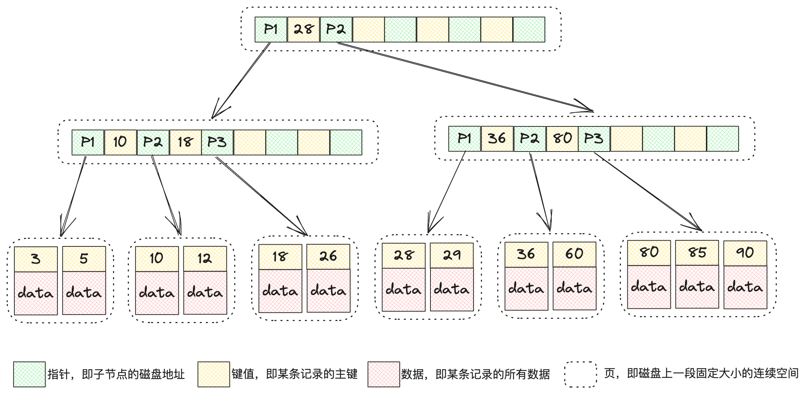
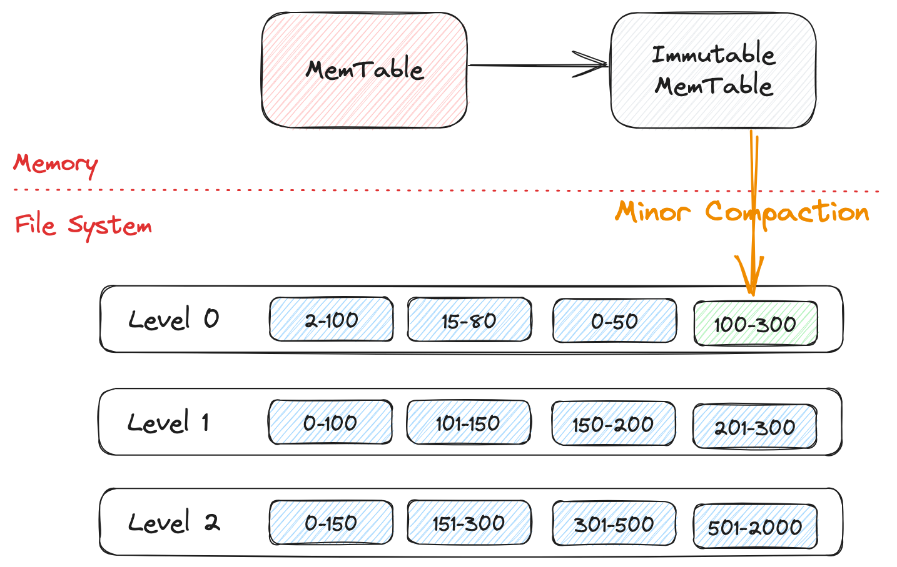
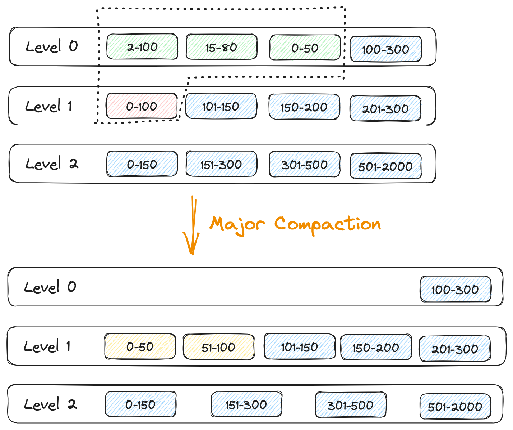

从 B+ Tree 到 LSM Tree，数据存储结构因数据规模而变。本文从「两棵树」说起，看看大数据时代为什么需要 LSM Tree。

# B Tree 与 B+ Tree

B Tree：日常我们说的「B 树」，是指 B-Tree（有时候也写成 B Tree），注意中间的 `-` 是连字符，不是减号，不要读成「B minus tree」，也不要把它当成 B 树的某个变种。

B Tree 是一棵「搜索树」，也就是对它进行中序遍历的话，结果是升序的。

B Tree 的发明动机是为了减少查找磁盘数据时的 IO 次数。

B+ Tree：而我们说的「B+ Tree」，则是 B Tree 的变种，读成「B plus tree」。与 B Tree 相比较，B+ Tree 的非叶子节点只存储键值与指针，只有叶子节点才存储具体的数据；另外一个区别是，B+ Tree 的叶子节点具有指向后一叶子节点的指针。

# B+ Tree 与传统关系型数据库

基于传统磁盘的传统关系型数据存储引擎，往往采用特殊的存储结构来降低查询时的磁盘 IO、提高查询性能。这种情况下，通常会采用一棵「矮胖」的树，最常见的就是 B+ Tree。

数据存储引擎一般有自己的逻辑存储单位，页（page，大小通常是几 KB）是其中一种比较普遍的叫法，数据库系统以页为单位为数据申请磁盘空间，读取的时候也是以页为单位，通常页的大小为文件系统块（block）的整数倍。存储引擎在使用 B+ Tree 进行磁盘存储时，一般被设计成树的每一个节点分别占用一个页。举例来说，MySQL InnoDB 存储引擎使用 16KB 为一页，一般主键如果是长整型（8B），而磁盘地址指针一般也是 8 字节，16KB/(8+8)=1K，即一页可以存储 1K 个记录（非叶子节点），或者换一种说法：这些节点的 `degree` 为 1K。

一棵树的 `degree` 如此大，最后就导致这是一棵「矮胖」的树。假设这棵树的 Depth 是 3，并且结构比较平衡，粗略计算：

- 第一层：1 个节点
- 第二层：1,000 个节点
- 第三层：1,000,000 个节点

由于叶子节点需要存储的是（索引键 + 行数据），假设 1 行数据大小 200 字节，每个节点（即页）可以存储 16KB/(8+200)≈76，总计可以索引 76,000,000 条数据。

在一棵「搜索树」上定位一条数据的 IO 次数等于树的高度，较矮的树可以缓解「读放大」的现象、提高查询性能。

# 从 B+ Tree 到 LSM Tree

使用树作为存储结构，存在随机读写的问题，B+ Tree 当然也无法幸免。不过，由于树高有限，同时关系型数据库引擎通常会加上缓存等优化手段，因此随机读的问题并不突出。相对的，B+ Tree 的随机写问题则突出得多，也更不好解决：数据写入、节点分裂、合并等等都会导致较多的随机写，从而影响写入性能。

传统关系型数据库通常数据量有限。当我们来到大数据时代，在海量数据的情况下，B+ Tree 的随机写问题则显得日益突出，于是出现了另外一棵「树」：LSM Tree（Log-Structured Merge Tree）。它的设计目标就是为了提供更好的写性能，它通过将磁盘的随机写转化为顺序写来提高写性能，代价是较差的读性能，以及额外的 Compaction。

LSM Tree 先在内存中构造一棵小树（通常也是一棵「搜索树」），当小树的尺寸达到门限，把整个小树作为一个整体进行写盘，一棵小树形成一个文件，很大程度上避免了随机写的问题。LevelDB 是典型的 LSM Tree 实现，下面主要以 LevelDB 为例进行说明（首先明确一下，LevelDB 是 KV 数据库，不是传统的关系型数据库）。

## 写入

随着用户写入数据，LevelDB 首先在内存中构造出一棵小树（即 memtable），当 memtable 的大小达到规定的阈值（默认 4MB），会被设置为仅可读的（即 immutable memtable），同时这些数据会被写入磁盘，形成一个 sstable，这个过程也称为 Minor Compaction。显然，immutable memtable 存在的主要目的是为了提高读性能。memtable 中的数据总是按 Key 排序的，因此每一个 sstable 内的数据也是有序的。

## Compaction

多次写盘之后，由于文件数量增加，读性能就会下降。虽然 LevelDB 的元数据信息中会记录每个 sstable 文件中 Key 的边界，但是由于用户在不断输入数据，两次写出的 sstable 的 Key 的范围可能存在重叠。当我们查找一个 key 时，可能需要读取多个文件，在最极端的情况下，需要把所有的文件都读取一遍。

为了缓解这个问题，LevelDB 需要进行 Major Compaction 操作：对多个 sstable 文件进行合并。下图 level-0 层中三个 sstable 文件，加上 level-1 层中的一个 sstable 文件，四个文件进行了合并，输出成两个按序组织的新的 level-1 层 sstable 文件进行替换。这个例子中，为什么在 Compaction 时需要引入 level-1 中的某个 sstable 文件？主要是为了确保新生成的 level-1 数据文件之间不会出现 key 范围重叠的情况。

Major Compaction 涉及将两棵树进行合并，需要大量的 IO，尤其在后期文件较大、无法一次加载到内存中时情况更严重，因此不能每次有新的 sstable 生成时都进行 Major Compaction，LevelDB 采取了一些策略：

- 当 0 层文件数超过预定的上限（默认为 4 个）；
- 当 level i 层文件的总大小超过 `10^i` MB；
- 当某个文件无效读取的次数过多。

## 查找

LSM 树在查找的过程比较直观，查找的顺序依次为：

1. memtable
2. immutable memtable
3. level 0
4. level 1
5. ……

其中，0 层的文件比较特殊。由于 0 层的文件中可能存在 key 重合的情况，因此在 0 层中，文件编号大的 sstable 优先查找，理由是文件编号较大的 sstable 中存储的总是最新的数据。非 0 层文件一层中所有文件之间的 key 不重合，因此 LevelDB 可以借助 sstable 的元数据（一个文件中最小与最大的 key 值）进行快速定位，每一层只需要查找一个 sstable 文件的内容。

另外，在根据 Key 定位到某个 sstable 文件后，LevelDB 还使用 Bloom Filter 来判断当前 Key 是否存在于该文件中，也能有效减少磁盘 IO 量。

# 最后

数据存储是信息时代的基石。在关系型数据库时代，B+ Tree 是主流的索引数据结构，依靠「矮胖」的结构，关系型数据库实现了高效的数据检索。但是，自 2000 年往后，随着数据量的爆炸性增长，B+ Tree 的写入性能成为了主要的瓶颈，人们转向使用 LSM Tree 来应对海量数据，这种结构将大量对树节点的随机写，转换成了一个文件的顺序写入，极大地提高了写入性能。

LSM Tree 在分布式大数据存储系统中得到了广泛应用，在常见的 NoSQL 数据库如 LevelDB、RocksDB、Cassandra、HBase、MongoDB 等等中都可以看到它，甚至一些关系型数据库如 MySQL，也提供了基于 LSM Tree 的存储引擎作为可选项。

从 B+ Tree 到 LSM Tree，我们可以窥见数据存储技术因时而变、因需而变的发展过程。不过，LSM Tree 存储结构同样存在缺陷（如「读放大」等问题），远没有达到一统天下的境界，B+ Tree 存储结构也远未消亡，数据存储技术仍然在不停向前演进。
